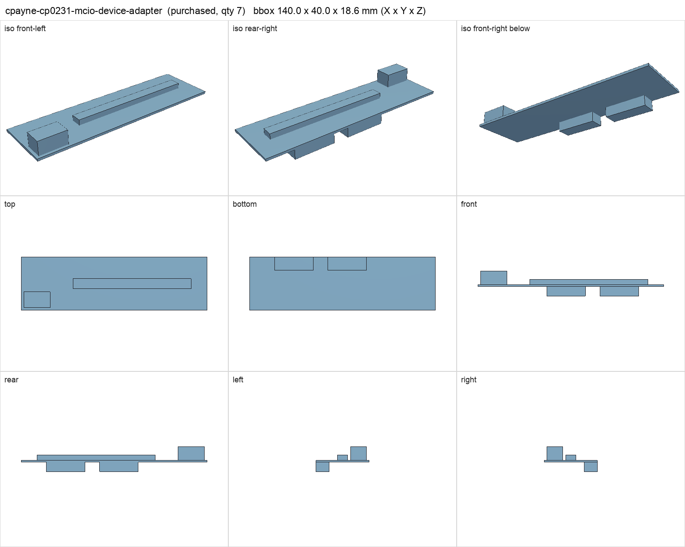

# C-Payne CP-0231 MCIO PCIe gen5 Device Adapter x8/x16 (BOTTOM)

<!-- Generated by make check from part.toml. Edit part.toml, not this file. -->

| | |
| --- | --- |
| ID | `cpayne-cp0231-mcio-device-adapter` |
| Category | purchased |
| Product | <https://c-payne.com/products/mcio-pcie-gen5-device-adapter-x8-x16> |
| Vendor_cad | <https://a360.co/3TxrU7w> |

Two MCIO 8i inputs on the underside; with one cable the slot runs x8 (use the
input nearest the power plug). 12 V power is mandatory (PEG, not EPS). C-Payne
publishes a 3D model (https://a360.co/3TxrU7w) but no 2D drawing: the PCB
outline, hole positions and slot position here are scaled from the product
photo and must be replaced from the 3D model or a measurement before printing.
Slot orientation (which end faces the bracket) is assumed.

## Used in

| Build | Qty | Status | Role |
| --- | ---: | --- | --- |
| [gpulab](../../../gpulab/parts/cpayne-cp0231-mcio-device-adapter.md) | 7 | candidate | GPU riser: MCIO 8i in, x16 slot (x8 electrical) for one GPU |

## Model

- [cpayne-cp0231-mcio-device-adapter.step](cpayne-cp0231-mcio-device-adapter.step)
- Source: constructed
- Vendor CAD: https://a360.co/3TxrU7w
- Written by the `gpulab` build's generator

## Datasheets

- [C-Payne CP-0231 product page](https://c-payne.com/products/mcio-pcie-gen5-device-adapter-x8-x16)
- Local copies: `datasheets/` after `make datasheets` (not committed)

## Dimensions

| Key | Value | Evidence | Source / note |
| --- | --- | --- | --- |
| pcb_length | 140 mm | photo-estimate | product photo, scaled to a ~40 mm board width |
| pcb_width | 40 mm | photo-estimate | product photo; similar boards are 38 mm |
| pcb_thickness | 1.6 mm | assumed |  |
| hole_diameter | 3.2 mm | photo-estimate | plated holes in the product photo, M3 class |
| hole_x_inner | 24 mm | photo-estimate | from the power-plug end |
| hole_x_outer | 133 mm | photo-estimate | from the power-plug end |
| hole_y_near | 13.6 mm | photo-estimate | from the long edge away from the MCIO cable entry |
| hole_y_far | 34.4 mm | photo-estimate | product photo, same edge as hole_y_near |
| slot_bracket_end_x | 128 mm | photo-estimate | slot body seen past the PCB edge |
| mcio_height_below_pcb | 7 mm | allowance | receptacle plus latch; unmeasured |
| mass | 0.05 kg | assumed |  |

## Interfaces

- provides `riser-x16-slot` value PCIe x16 count 1 (datasheet)
- requires `mcio-8i-cable` count 1 (photo-estimate)
- requires `pcie-8pin` count 1 (photo-estimate) — 2x3 power footprint in the photo: a PCIe 6-pin, fed from a 6+2 lead
- requires `riser-standoff` value M3 F/F 10 mm count 4 (photo-estimate)
- requires `dc-power` load 5 (allowance) — 3.3 V buck for the slot; GPU slot 12 V counted in each GPU's board power

