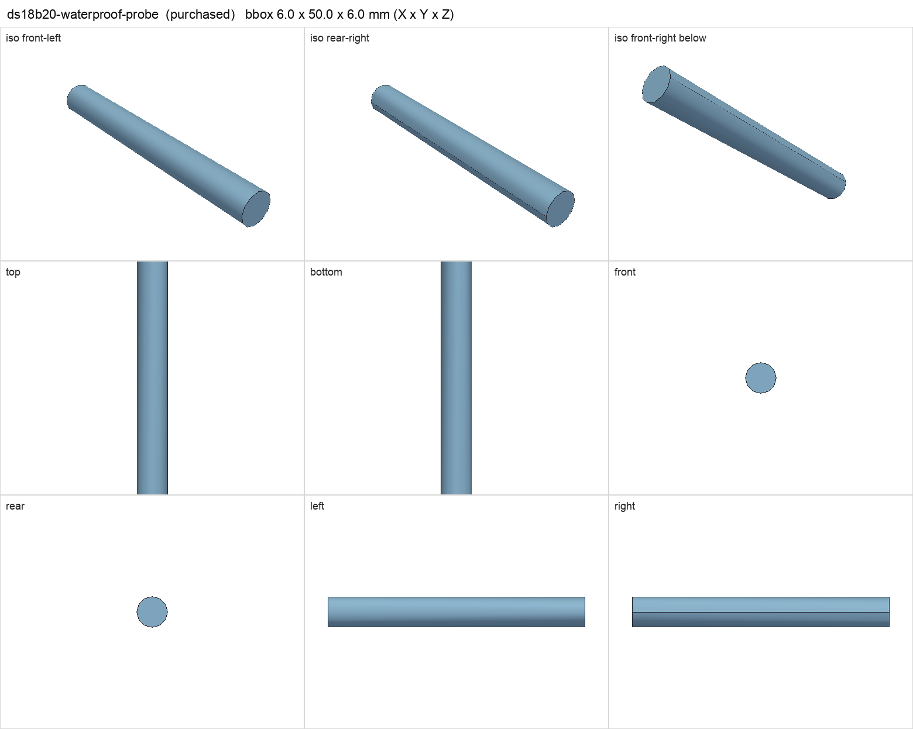

# DS18B20 waterproof probe (stainless tube, 3-wire cable)

<!-- Generated by make check from part.toml. Edit part.toml, not this file. -->

| | |
| --- | --- |
| ID | `ds18b20-waterproof-probe` |
| Category | purchased |

Generic probe around an Analog Devices (Maxim) DS18B20 sensor. The sensor values are
from the datasheet; the tube, cable length and wire colours vary by seller, so check
them against the listing you buy (usually red VDD, black GND, yellow or white DQ).
Powered from 3.3 V on three wires (not parasite mode). Both probes share one 1-Wire bus;
each has a unique 64-bit ROM code, which the firmware uses to tell intake from exhaust.
A reading of exactly 85.0 C is the sensor's power-on value and usually means a bad read.

## Used in

| Build | Qty | Status | Role |
| --- | ---: | --- | --- |
| [rack](../../../rack/parts/ds18b20-waterproof-probe.md) | 2 | selected | intake and exhaust air temperature probes |

## Model

- [ds18b20-waterproof-probe.step](ds18b20-waterproof-probe.step)
- Source: constructed. Tube envelope only.
- Written by the `rack` build's generator

## Datasheets

- [DS18B20 data sheet Rev. 6](https://www.analog.com/media/en/technical-documentation/data-sheets/DS18B20.pdf)
- Local copies: `datasheets/` after `make datasheets` (not committed)

## Dimensions

| Key | Value | Evidence | Source / note |
| --- | --- | --- | --- |
| accuracy | 0.5 C | datasheet | DS18B20 Rev. 6: +/-0.5 C from -10 to +85 C |
| supply_min | 3 V | datasheet | DS18B20 Rev. 6: 3.0 to 5.5 V |
| conversion_time_12bit | 750 ms | datasheet | DS18B20 Rev. 6: max conversion time at 12 bits |
| tube_diameter | 6 mm | assumed | typical probe; measure the one bought |
| tube_length | 50 mm | assumed | typical probe; measure the one bought |
| cable_length | **unknown**  | unknown | buy 1 m for the intake and 2 m for the exhaust probe, or as the cabinet needs |

## Interfaces

- requires `onewire-port` value 3.3 V, DQ, GND count 1 (datasheet)

