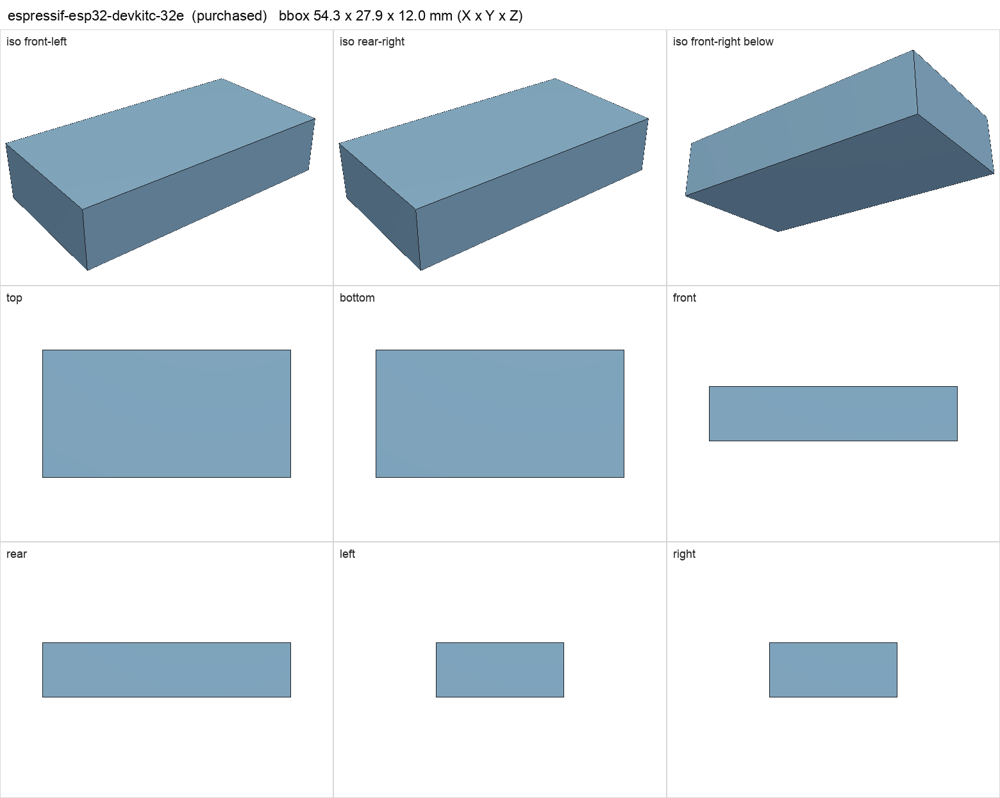

# Espressif ESP32-DevKitC-32E (DevKitC V4, ESP32-WROOM-32E)

<!-- Generated by make check from part.toml. Edit part.toml, not this file. -->

| | |
| --- | --- |
| ID | `espressif-esp32-devkitc-32e` |
| Category | purchased |

Classic ESP32, chosen because it has eight hardware pulse counters (PCNT): one per
fan tach. The ESP32-S2/S3/C3 have four or none. Powered through the 5V pin (J2-19)
only; never connect USB and the 5V pin at the same time (Espressif: use one and only
one power source). Unplug the 5V feed before flashing over USB.
GPIO6-11 drive the flash; GPIO0, 2, 5, 12 and 15 are strapping pins; GPIO34-39 are
input-only without internal pull-ups. The PCB antenna sits 6.04 mm past the board end:
inside a closed metal cabinet Wi-Fi may be weak, see rack/docs/design.md.

## Used in

| Build | Qty | Status | Role |
| --- | ---: | --- | --- |
| [rack](../../../rack/parts/espressif-esp32-devkitc-32e.md) | 1 | selected | fan controller: reads both probes and all eight tachs, drives the two PWM channels, runs ESPHome |

## Model

- [espressif-esp32-devkitc-32e.step](espressif-esp32-devkitc-32e.step)
- Source: constructed. Board envelope with the antenna overhang; headers not modeled.
- Written by the `rack` build's generator

## Datasheets

- [ESP32-DevKitC V4 user guide](https://docs.espressif.com/projects/esp-dev-kits/en/latest/esp32/esp32-devkitc/user_guide.html)
- [ESP32-DevKitC V4 dimensions](https://dl.espressif.com/dl/schematics/esp32_devkitc_v4_dimensions.pdf)
- [ESP32-WROOM-32E datasheet](https://www.espressif.com/sites/default/files/documentation/esp32-wroom-32e_esp32-wroom-32ue_datasheet_en.pdf)
- Local copies: `datasheets/` after `make datasheets` (not committed)

## Dimensions

| Key | Value | Evidence | Source / note |
| --- | --- | --- | --- |
| board_width | 27.94 mm | datasheet | DevKitC V4 dimensions drawing |
| board_length | 48.26 mm | datasheet | DevKitC V4 dimensions drawing |
| antenna_overhang | 6.04 mm | datasheet | DevKitC V4 dimensions drawing |
| header_row_spacing | 25.4 mm | datasheet | DevKitC V4 dimensions drawing |
| header_pitch | 2.54 mm | datasheet | DevKitC V4 dimensions drawing |
| supply_current_3v3 | 0.5 A | datasheet | WROOM-32E datasheet: current delivered by external supply, min 0.5 A |
| wifi_tx_peak | 379 mA | datasheet | WROOM-32E datasheet table 16: 802.11b 19.5 dBm peak |

## Interfaces

- requires `devkitc-socket` count 1 (datasheet)
- requires `dc-5v` load 2.5 W (datasheet) — 0.5 A supply rating at the 3.3 V regulator input, taken at 5 V because the board regulator is linear

