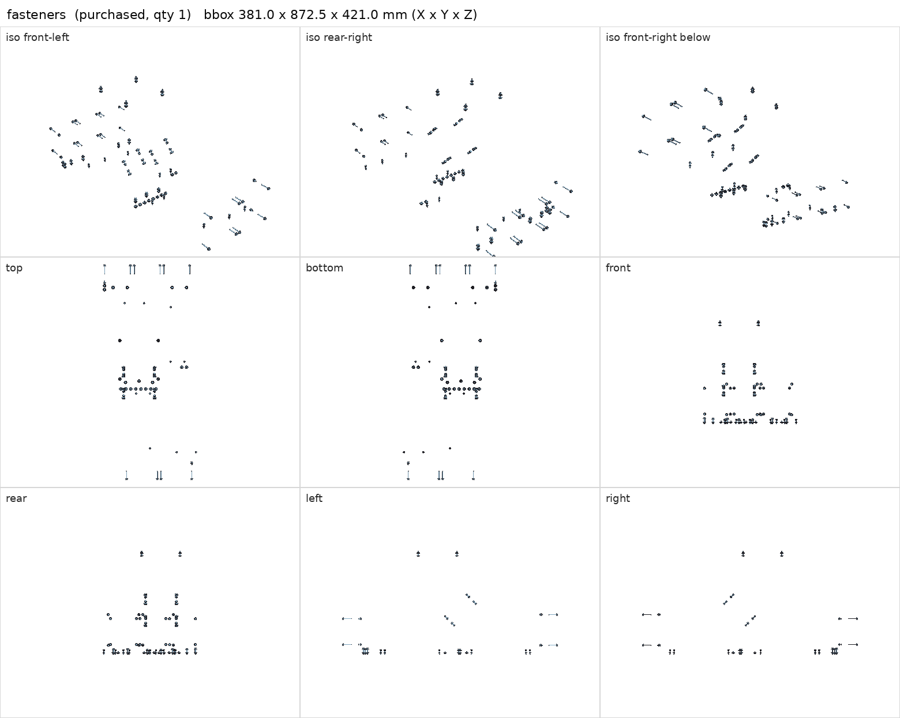
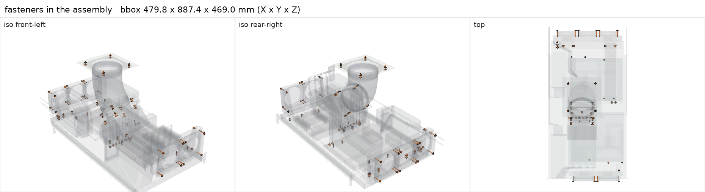

# Shelf and component fasteners (M3/M4 screws, washers, nuts)

<!-- Generated by make check from part.toml. Edit part.toml, not this file. -->

| | |
| --- | --- |
| ID | `fasteners` |
| Category | purchased |
| Role | 45 shelf joints plus radiator, fan, flange and roof screws |
| Status | candidate |
| Quantity | 1 |
| Systems | berserk, kenshin, shelf |

## Model

- [fasteners.step](fasteners.step)
- Source: constructed. Shafts, heads and washers at nominal size; the model is one representative set.
- Assembly: 87 instances in the assembly

## Datasheets

- None recorded. Generic ISO metric hardware; choose lengths from measured stacks (see docs/assembly.md).

## Dimensions

| Key | Value | Evidence | Source / note |
| --- | --- | --- | --- |
| mass | 0.6 kg | assumed |  |

## Compatibility checks

| Status | Rule | Interface | Detail |
| --- | --- | --- | --- |
| provisional | budget | `shelf-load` | load 23.7 kg of 39.0 kg x derate 1.0 = 39.0 kg (61% of rating) |

