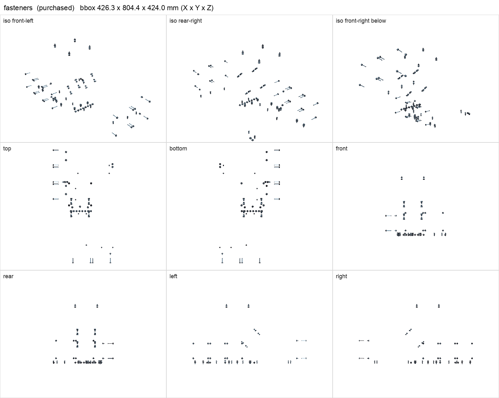

# Shelf and component fasteners (metric and UNC screws, washers, nuts)

<!-- Generated by make check from part.toml. Edit part.toml, not this file. -->

| | |
| --- | --- |
| ID | `fasteners` |
| Category | purchased |

## Used in

| Build | Qty | Status | Role |
| --- | ---: | --- | --- |
| [aipc](../../../aipc/parts/fasteners.md) | 1 | candidate | 45 shelf joints plus radiator, fan, flange and roof screws |
| [gpulab](../../../gpulab/parts/fasteners.md) | 1 | candidate | post, board, baseboard and riser fasteners |
| [rack](../../../rack/parts/fasteners.md) | 1 | candidate | fan-to-panel screws (four per fan, 32 in all) plus spares |

## Model

- [fasteners.step](fasteners.step)
- Source: constructed. Shafts, heads and washers at nominal size; the model is one representative AIPC set.
- Written by the `aipc` build's generator

## Datasheets

- None recorded. Generic ISO metric and UNC hardware; each build chooses lengths from its own stacks.

