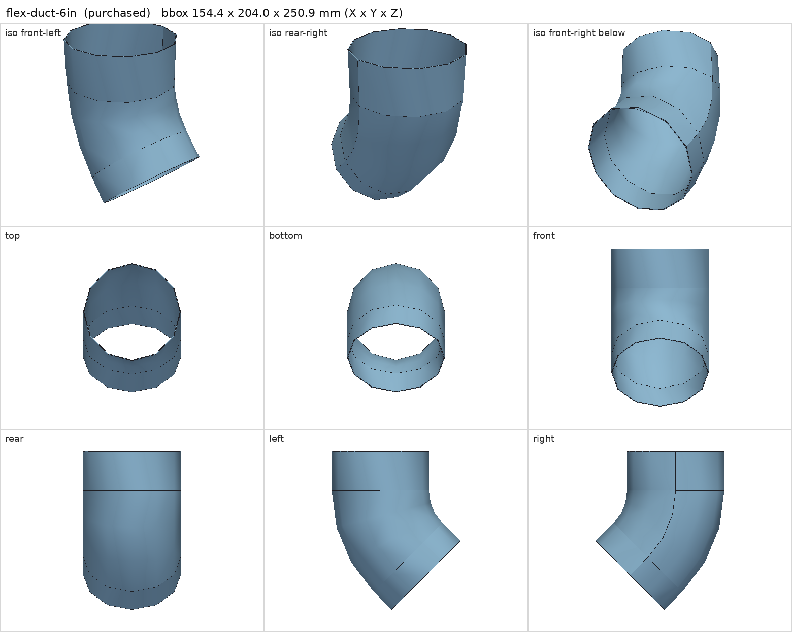

# 6 in wire-supported flexible duct, uninsulated

<!-- Generated by make check from part.toml. Edit part.toml, not this file. -->

| | |
| --- | --- |
| ID | `flex-duct-6in` |
| Category | purchased |

## Used in

| Build | Qty | Status | Role |
| --- | ---: | --- | --- |
| [aipc](../../../aipc/parts/flex-duct-6in.md) | 1 | candidate | GPU exhaust to cabinet ceiling |

## Model

- [flex-duct-6in.step](flex-duct-6in.step)
- Source: constructed
- Written by the `aipc` build's generator

## Datasheets

- None recorded. Not selected; any 152 mm ID wire-supported duct.

## Interfaces

- requires `duct-connection` value 6 in count 2 (allowance)

