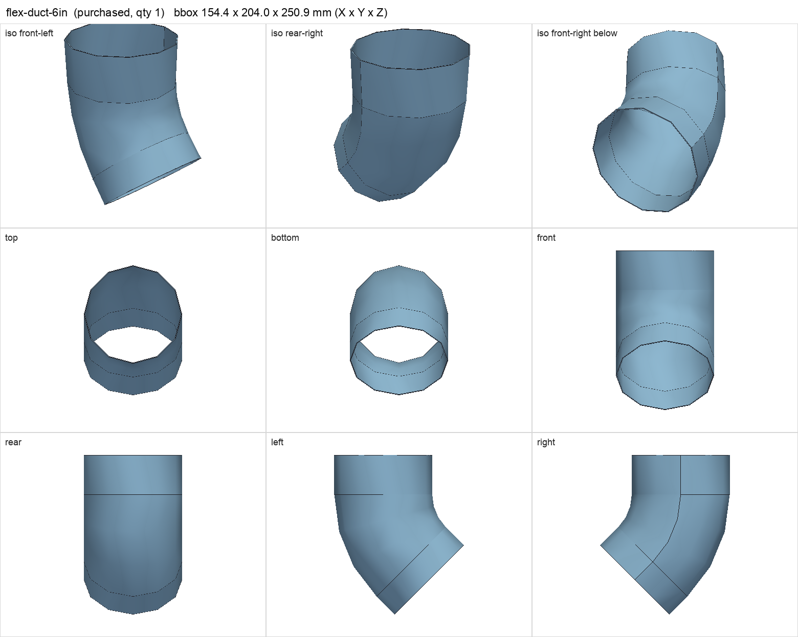
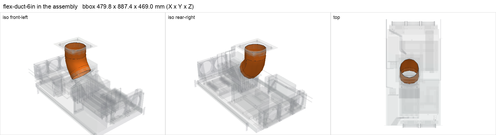

# 6 in wire-supported flexible duct, uninsulated

<!-- Generated by make check from part.toml. Edit part.toml, not this file. -->

| | |
| --- | --- |
| ID | `flex-duct-6in` |
| Category | purchased |
| Role | GPU exhaust to cabinet ceiling |
| Status | candidate |
| Quantity | 1 |
| Systems | berserk |

## Model

- [flex-duct-6in.step](flex-duct-6in.step)
- Source: constructed
- Assembly: 1 instances in the assembly

## Datasheets

- None recorded. Not selected; any 152 mm ID wire-supported duct.

## Interfaces

- requires `duct-connection` value 6 in count 2 (allowance)

## Compatibility checks

| Status | Rule | Interface | Detail |
| --- | --- | --- | --- |
| provisional | value | `duct-connection` | flex-duct-6in needs 6 in; provided by gpu_exhaust_fan_flange, gpu_exhaust_roof_flange |
| provisional | count | `duct-connection` | need 2 x duct-connection=6 in, have 2 |

