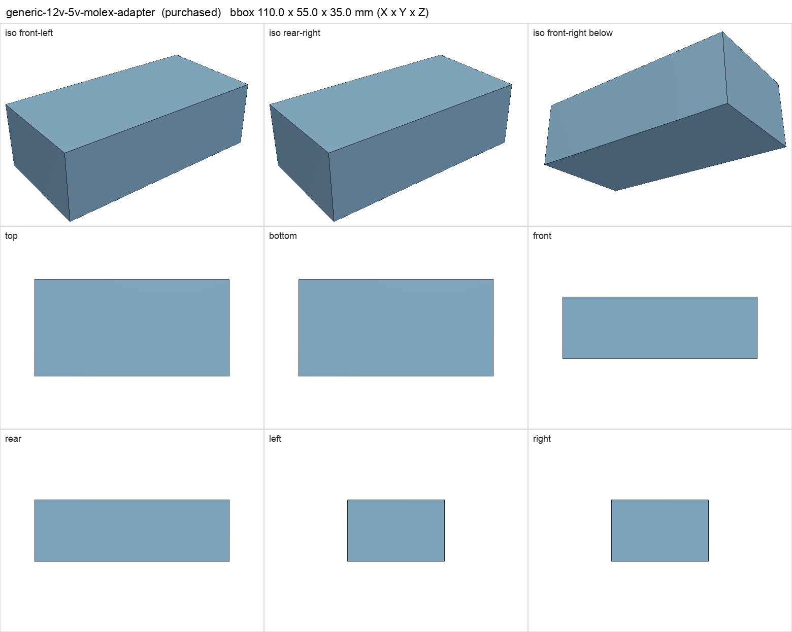

# Generic 12 V + 5 V desktop adapter with a 4-pin Molex plug (not chosen)

<!-- Generated by make check from part.toml. Edit part.toml, not this file. -->

| | |
| --- | --- |
| ID | `generic-12v-5v-molex-adapter` |
| Category | purchased |

The kind sold to power external hard-drive docks and test benches: mains in, 12 V and
5 V out on a 4-pin Molex (HDD) plug that fits the QUADRO's power connector directly.
No model chosen. Buy one rated at least 12 V 1.5 A and 5 V 1.5 A, with a CE or UL mark
and stated short-circuit and overload protection; check the Molex pin order
(1 +12 V, 2-3 GND, 4 +5 V) with a meter before connecting. The capacities below are
those minimums, not a datasheet.

## Used in

| Build | Qty | Status | Role |
| --- | ---: | --- | --- |
| [rack](../../../rack/parts/generic-12v-5v-molex-adapter.md) | 1 | candidate | 12 V and 5 V for the QUADRO and, through it, the fans; plugged into the rack PDU |

## Model

- [generic-12v-5v-molex-adapter.step](generic-12v-5v-molex-adapter.step)
- Source: constructed. Case envelope from the minimum allowance.
- Written by the `rack` build's generator

## Datasheets

- None recorded. generic part, no make or model chosen yet

## Dimensions

| Key | Value | Evidence | Source / note |
| --- | --- | --- | --- |
| length | 110 mm | allowance | typical brick size; replace with the bought unit |
| width | 55 mm | allowance | typical brick size; replace with the bought unit |
| height | 35 mm | allowance | typical brick size; replace with the bought unit |
| output_cable_length | 1000 mm | allowance | typical; replace with the bought unit |
| mass | 0.25 kg | assumed |  |

## Interfaces

- provides `dc-12v` capacity 18 W (allowance) — minimum to buy: 12 V 1.5 A
- provides `dc-5v` capacity 7.5 W (allowance) — minimum to buy: 5 V 1.5 A
- provides `molex-4pin-power` value 12 V + 5 V, 4-pin Molex (HDD) plug count 1 (unknown)
- requires `ac-power` load 17 W (allowance) — about 13.7 W out (8 fans at 0.96 W plus 5 W for the QUADRO) at an assumed 80% efficiency

