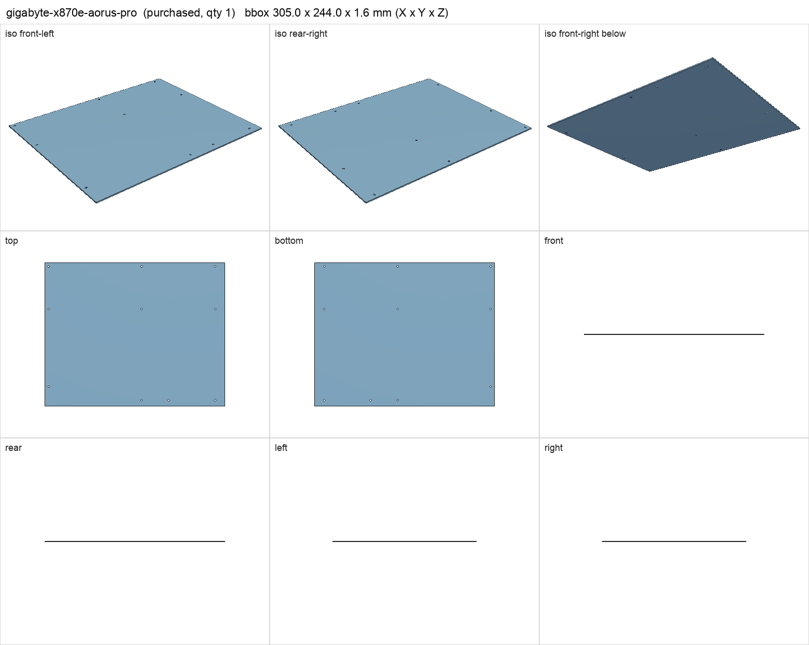
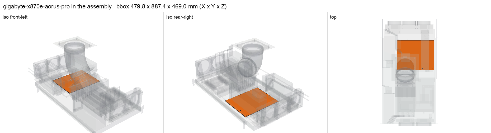

# Gigabyte X870E AORUS PRO (ATX)

<!-- Generated by make check from part.toml. Edit part.toml, not this file. -->

| | |
| --- | --- |
| ID | `gigabyte-x870e-aorus-pro` |
| Category | purchased |
| Role | Kenshin motherboard |
| Status | owned |
| Quantity | 1 |
| Systems | kenshin |

Turned 180 degrees on the shelf; rear I/O faces the centre corridor. M.2 count and EPS header count need checking against the spec page.

## Model

- [gigabyte-x870e-aorus-pro.step](gigabyte-x870e-aorus-pro.step)
- Source: constructed
- Assembly: 1 instances in the assembly

## Datasheets

- [X870E AORUS PRO specifications](https://www.gigabyte.com/Motherboard/X870E-AORUS-PRO-rev-10/sp)
- Local copies: `datasheets/` after `make datasheets` (not committed)

## Dimensions

| Key | Value | Evidence | Source / note |
| --- | --- | --- | --- |
| pcb_width | 305 mm | datasheet | ATX form factor 30.5 x 24.4 cm |
| pcb_depth | 244 mm | datasheet | ATX form factor 30.5 x 24.4 cm |
| mass | 1.3 kg | assumed |  |

## Interfaces

- provides `cpu-socket` value AM5 (datasheet)
- provides `memory-slot` value DDR5 UDIMM count 4 (datasheet)
- provides `pcie-x16-slot` value PCIe x16 count 1 (datasheet) — primary PCIe 5.0 x16
- provides `m2-slot` value M.2 2280 NVMe count 4 (assumed)
- requires `board-standoff` value #6-32 F/F count 9 (standard) — ATX pattern; B optional if the PCB has it
- requires `mobo-front-section` value ATX count 1 (datasheet)
- requires `mobo-rear-rail` value ATX standard slot positions count 1 (datasheet)
- requires `atx-24pin` count 1 (datasheet)
- requires `eps-8pin-cpu` count 2 (assumed)
- requires `dc-power` load 50 (assumed)

## Compatibility checks

| Status | Rule | Interface | Detail |
| --- | --- | --- | --- |
| BLOCKED | budget | `shelf-load` | load 23.1 kg of 39.0 kg x derate 1.0 = 39.0 kg (59% of rating); unknown load for ['fan-controller'] |
| provisional | count | `atx-24pin` | need 1 x atx-24pin, have 1 |
| provisional | value | `board-standoff` | gigabyte-x870e-aorus-pro needs #6-32 F/F; provided by keystone-1451b |
| provisional | count | `board-standoff` | need 17 x board-standoff=#6-32 f/f, have 17 |
| provisional | budget | `dc-power` | load 908.0 W of 1200.0 W x derate 0.8 = 960.0 W (76% of rating) |
| provisional | count | `eps-8pin-cpu` | need 2 x eps-8pin-cpu, have 2 |
| provisional | value | `m2-slot` | samsung-990-pro-4tb needs M.2 2280 NVMe; provided by gigabyte-x870e-aorus-pro |
| provisional | count | `m2-slot` | need 2 x m2-slot=m.2 2280 nvme, have 4 |
| provisional | value | `memory-slot` | corsair-cmp64gx5m4b6400c32 needs DDR5 UDIMM; provided by gigabyte-x870e-aorus-pro |
| provisional | count | `memory-slot` | need 4 x memory-slot=ddr5 udimm, have 4 |
| provisional | value | `mobo-front-section` | gigabyte-x870e-aorus-pro needs ATX; provided by atx_mobo_adapter_front |
| provisional | count | `mobo-front-section` | need 2 x mobo-front-section=atx, have 2 |
| provisional | value | `mobo-rear-rail` | gigabyte-x870e-aorus-pro needs ATX standard slot positions; provided by atx_mobo_adapter_rail |
| provisional | count | `mobo-rear-rail` | need 1 x mobo-rear-rail=atx standard slot positions, have 1 |
| pass | value | `cpu-socket` | amd-ryzen-9-9950x3d needs AM5; provided by gigabyte-x870e-aorus-pro |
| pass | value | `pcie-x16-slot` | zotac-rtx-5090-solid needs PCIe x16; provided by gigabyte-x870e-aorus-pro |
| pass | count | `pcie-x16-slot` | need 1 x pcie-x16-slot=pcie x16, have 1 |

