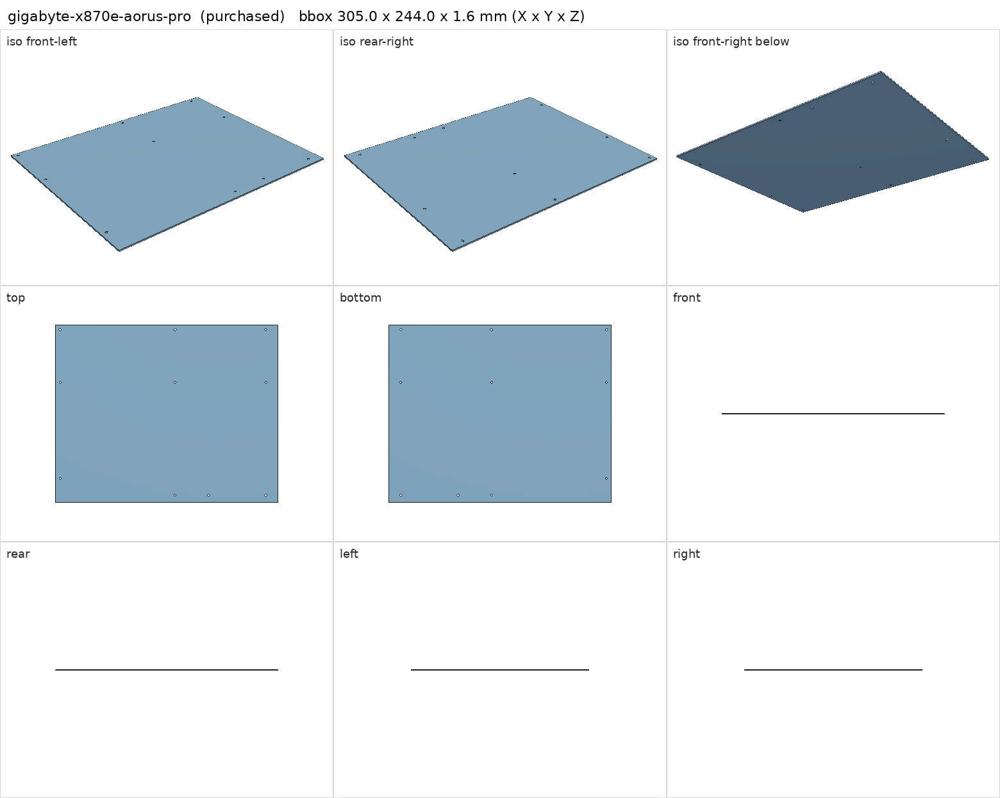

# Gigabyte X870E AORUS PRO (ATX)

<!-- Generated by make check from part.toml. Edit part.toml, not this file. -->

| | |
| --- | --- |
| ID | `gigabyte-x870e-aorus-pro` |
| Category | purchased |

Turned 180 degrees on the shelf; rear I/O faces the centre corridor. M.2 count and EPS header count need checking against the spec page.

## Used in

| Build | Qty | Status | Role |
| --- | ---: | --- | --- |
| [aipc](../../../aipc/parts/gigabyte-x870e-aorus-pro.md) | 1 | owned | Kenshin motherboard |

## Model

- [gigabyte-x870e-aorus-pro.step](gigabyte-x870e-aorus-pro.step)
- Source: constructed
- Written by the `aipc` build's generator

## Datasheets

- [X870E AORUS PRO specifications](https://www.gigabyte.com/Motherboard/X870E-AORUS-PRO-rev-10/sp)
- Local copies: `datasheets/` after `make datasheets` (not committed)

## Dimensions

| Key | Value | Evidence | Source / note |
| --- | --- | --- | --- |
| pcb_width | 305 mm | datasheet | ATX form factor 30.5 x 24.4 cm |
| pcb_depth | 244 mm | datasheet | ATX form factor 30.5 x 24.4 cm |
| mass | 1.3 kg | assumed |  |

## Interfaces

- provides `cpu-socket` value AM5 (datasheet)
- provides `memory-slot` value DDR5 UDIMM count 4 (datasheet)
- provides `pcie-x16-slot` value PCIe x16 count 1 (datasheet) — primary PCIe 5.0 x16
- provides `pcie-x4-slot` value PCIe x8 card, x4 link count 2 (datasheet) — rev 1.0 spec page: two chipset x16-size slots running at x4, PCIEX4_1 PCIe 4.0 and PCIEX4_2 PCIe 3.0. Whether the RTX 5090 cooler covers either slot is unchecked, and the board revision is not yet confirmed on the PCB
- provides `m2-slot` value M.2 2280 NVMe count 4 (assumed)
- requires `board-standoff` value #6-32 F/F count 9 (standard) — ATX pattern; B optional if the PCB has it
- requires `mobo-front-section` value ATX count 1 (datasheet)
- requires `mobo-rear-rail` value ATX standard slot positions count 1 (datasheet)
- requires `atx-24pin` count 1 (datasheet)
- requires `eps-8pin-cpu` count 2 (assumed)
- requires `dc-power` load 50 (assumed)

