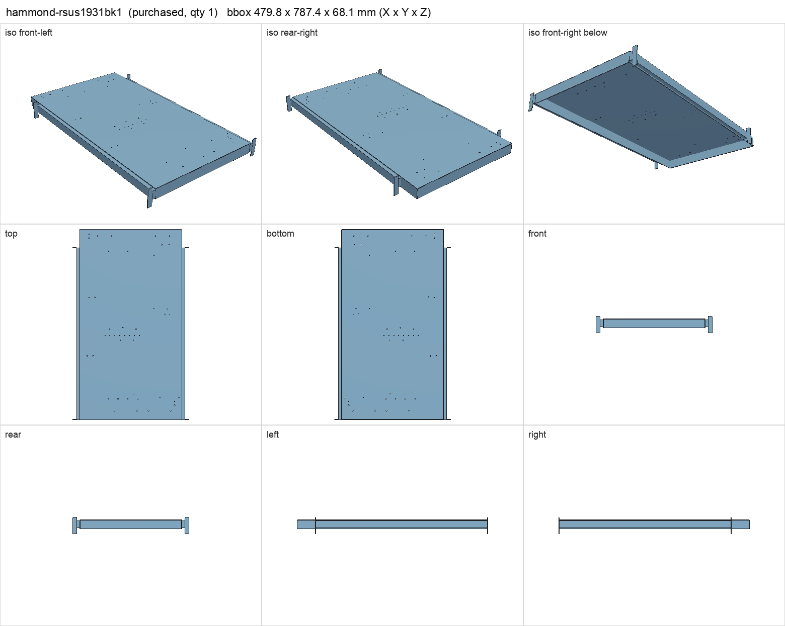
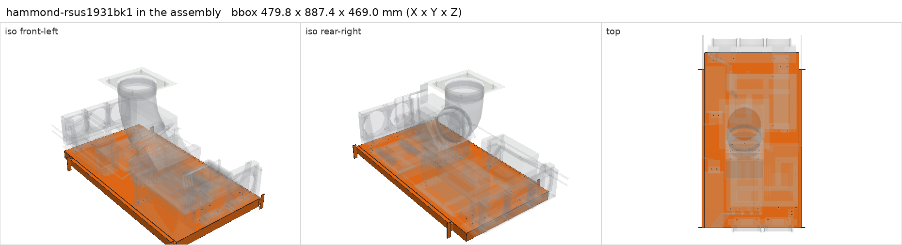

# Hammond RSUS1931BK1 solid sliding shelf with factory slides

<!-- Generated by make check from part.toml. Edit part.toml, not this file. -->

| | |
| --- | --- |
| ID | `hammond-rsus1931bk1` |
| Category | purchased |
| Role | sliding shelf carrying both PCs |
| Status | selected |
| Quantity | 1 |
| Systems | shelf, rack |
| Product | <https://www.hammfg.com/dci/products/accessories/rsus> |

Shelf alone: 2U mounting, 3U clearance. The loaded build needs far more
height; the rack-unit requirement lives in parts/system.toml.

Selected 2026-11-05; purchase not confirmed. The current series table and the
individual drawing disagree on load rating (85 lb vs 120 lb) and mounting depth
(18-28 in vs 8-28 in); the stricter series-table values are used. Slide closed
length, cross-section and bracket hole pattern are not published: the slide
envelopes in the assembly are illustrative, not factory CAD.

## Model

- [hammond-rsus1931bk1.step](hammond-rsus1931bk1.step)
- Source: constructed. Deck outer dimensions from the series table; folds, slides and rack brackets are envelopes.
- Assembly: 11 instances in the assembly

## Datasheets

- [RSUS series specification table](https://www.hammfg.com/dci/products/accessories/rsus)
- [RSUS1931BK1 drawing](https://www.hammfg.com/files/parts/pdf/RSUS1931BK1.pdf)
- [Installation bulletin BUL87361](https://www.hammfg.com/files/parts/bulletins/BUL87361.pdf)
- Local copies: `datasheets/` after `make datasheets` (not committed)

## Dimensions

| Key | Value | Evidence | Source / note |
| --- | --- | --- | --- |
| deck_width | 422.656 mm | datasheet | series table 16.64 in |
| deck_depth | 787.4 mm | datasheet | series table 31 in |
| sheet_thickness | 1.52 mm | allowance | 16 gauge nominal; measure steel and coating |
| fold_height | 38.1 mm | datasheet | drawing 1.5 in |
| overall_height | 68.072 mm | datasheet | drawing 2.68 in |
| overall_width | 479.806 mm | datasheet | drawing 18.89 in |
| rack_hole_pitch | 466.344 mm | datasheet | drawing 18.36 in |
| slide_travel | 711.2 mm | datasheet | series table 28 in |
| mount_depth_min | 457.2 mm | datasheet | series table 18 in (drawing says 8 in) |
| mount_depth_max | 711.2 mm | datasheet | series table 28 in |
| load_rating | 39 kg | datasheet | series table 85 lb (drawing says 120 lb) |
| slide_closed_length | 711.2 mm | photo-estimate | drawing L.S. view scale reading (~28 in); not dimensioned |
| front_bracket_setback | 0 mm | photo-estimate | drawing top view: front bracket flange flush with deck front |
| rear_bracket_from_deck_rear | 76.2 mm | photo-estimate | drawing top view at 28 in rail distance (scale reading 67-76 mm) |
| slide_cross_section | **unknown**  | unknown | not published |

## Interfaces

- provides `shelf-load` capacity 39 kg (datasheet) — stricter current series-table rating
- requires `rack-standard` value EIA-310 19 in (datasheet)
- requires `rack-post-depth` min 457.2 max 711.2 (datasheet) — front-to-rear rack-post spacing range accepted by the slides

## Compatibility checks

| Status | Rule | Interface | Detail |
| --- | --- | --- | --- |
| BLOCKED | value | `rack-post-depth` | hammond-rsus1931bk1 needs 457.2..711.2; provider value unknown |
| BLOCKED | value | `rack-standard` | hammond-rsus1931bk1 needs EIA-310 19 in; provider value unknown |
| provisional | budget | `shelf-load` | load 23.7 kg of 39.0 kg x derate 1.0 = 39.0 kg (61% of rating) |

