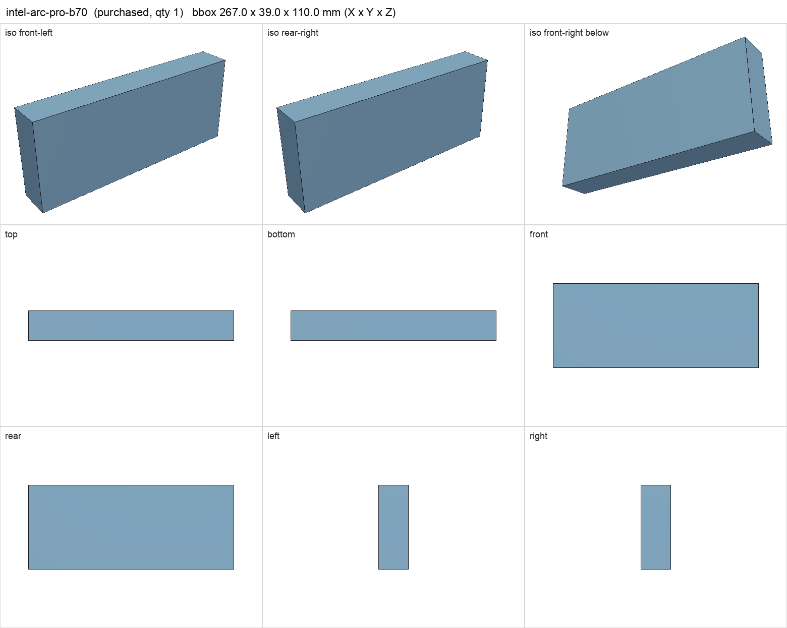

# Intel Arc Pro B70 32 GB (Intel reference)

<!-- Generated by make check from part.toml. Edit part.toml, not this file. -->

| | |
| --- | --- |
| ID | `intel-arc-pro-b70` |
| Category | purchased |
| Product | <https://www.intel.com/content/www/us/en/products/sku/245797/intel-arc-pro-b70-graphics/specifications.html> |

Launched Q1 2026. Blower: air exits through the bracket.
Occupies 3 positions (thickness plus a few mm air gap at the 20.32 mm pitch).
Running on an MCIO riser at x8; values marked review/listing are provisional.

## Used in

| Build | Qty | Status | Role |
| --- | ---: | --- | --- |
| [gpulab](../../../gpulab/parts/intel-arc-pro-b70.md) | 1 | candidate | GPU under test (blower cooler), 3 baseboard positions |

## Model

- [intel-arc-pro-b70.step](intel-arc-pro-b70.step)
- Source: constructed. Body envelope only: length x height x thickness.
- Written by the `gpulab` build's generator

## Datasheets

- [Intel Arc Pro B70 specifications](https://www.intel.com/content/www/us/en/products/sku/245797/intel-arc-pro-b70-graphics/specifications.html)
- Local copies: `datasheets/` after `make datasheets` (not committed)

## Dimensions

| Key | Value | Evidence | Source / note |
| --- | --- | --- | --- |
| length | 267 mm | datasheet | Intel: 10.5 in |
| height | 110 mm | review | Igor's Lab; Intel lists 3.9 in (99 mm), probably without the bracket |
| thickness | 39 mm | review | Igor's Lab; Intel: 2-slot |
| tgp | 230 W | datasheet | Intel TBP; partner boards 160-290 W |
| mass | 1.02 kg | review | review |
| power_connector_from_tail | 0 mm | allowance | 8-pin on the tail end (blower), from product photos; 0 means on the tail end. Not measured |

## Interfaces

- requires `riser-x16-slot` value PCIe x16 count 1 (datasheet) — PCIe 5.0 x16 card on an x8 riser link
- requires `gpu-baseboard-position` count 3 (allowance)
- requires `pcie-8pin` count 1 (datasheet) — 1 x 8-pin PCIe
- requires `dc-power` load 230 load_limited 190 (datasheet) — stock board power, including the 75 W slot power drawn through the riser; capped to 190 W for the 2800 W PSU budget: xpu-smi config -d <gpu> --powerlimit 190, set at boot and confirm the driver accepts it

