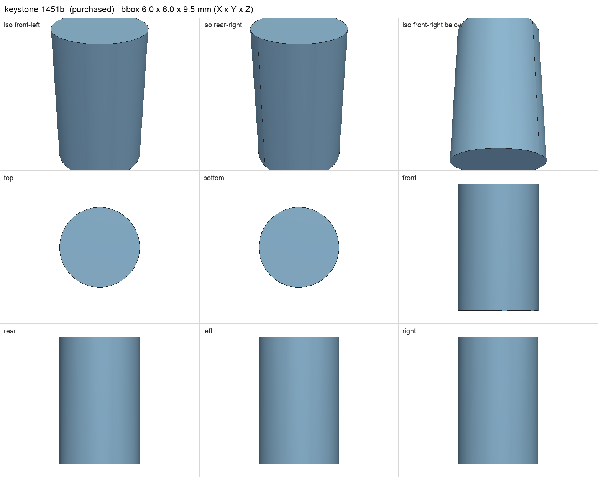

# Keystone 1451B #6-32 F/F brass standoff, 3/8 in

<!-- Generated by make check from part.toml. Edit part.toml, not this file. -->

| | |
| --- | --- |
| ID | `keystone-1451b` |
| Category | purchased |

## Used in

| Build | Qty | Status | Role |
| --- | ---: | --- | --- |
| [aipc](../../../aipc/parts/keystone-1451b.md) | 17 | selected | motherboard standoffs |
| [gpulab](../../../gpulab/parts/keystone-1451b.md) | 8 | selected | H12D-8D motherboard standoffs on the printed mount, screwed from below through its sections |

## Model

- [keystone-1451b.step](keystone-1451b.step)
- Source: constructed
- Written by the `aipc` build's generator

## Datasheets

- None recorded. Only the DigiKey listing is recorded; add Keystone's drawing.

## Dimensions

| Key | Value | Evidence | Source / note |
| --- | --- | --- | --- |
| length | 9.525 mm | listing | part number 3/8 in |
| mass | 0.002 kg | assumed |  |

## Interfaces

- provides `board-standoff` value #6-32 F/F count 1 (listing)

