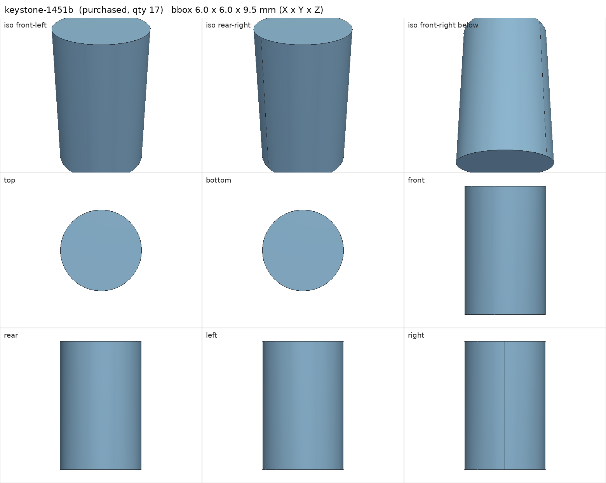
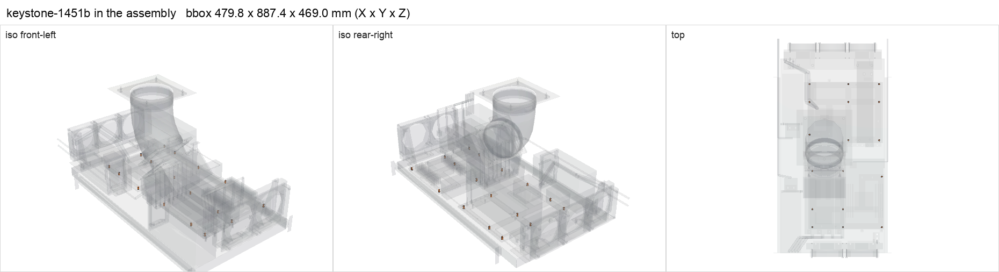

# Keystone 1451B #6-32 F/F brass standoff, 3/8 in

<!-- Generated by make check from part.toml. Edit part.toml, not this file. -->

| | |
| --- | --- |
| ID | `keystone-1451b` |
| Category | purchased |
| Role | motherboard standoffs |
| Status | selected |
| Quantity | 17 |
| Systems | berserk, kenshin |

## Model

- [keystone-1451b.step](keystone-1451b.step)
- Source: constructed
- Assembly: 17 instances in the assembly

## Datasheets

- None recorded. Only the DigiKey listing is recorded; add Keystone's drawing.

## Dimensions

| Key | Value | Evidence | Source / note |
| --- | --- | --- | --- |
| length | 9.525 mm | listing | part number 3/8 in |
| mass | 0.002 kg | assumed |  |

## Interfaces

- provides `board-standoff` value #6-32 F/F count 1 (listing)

## Compatibility checks

| Status | Rule | Interface | Detail |
| --- | --- | --- | --- |
| provisional | value | `board-standoff` | gigabyte-x870e-aorus-pro needs #6-32 F/F; provided by keystone-1451b |
| provisional | value | `board-standoff` | huananzhi-h12d-8d needs #6-32 F/F; provided by keystone-1451b |
| provisional | count | `board-standoff` | need 17 x board-standoff=#6-32 f/f, have 17 |
| provisional | budget | `shelf-load` | load 23.3 kg of 39.0 kg x derate 1.0 = 39.0 kg (60% of rating) |

