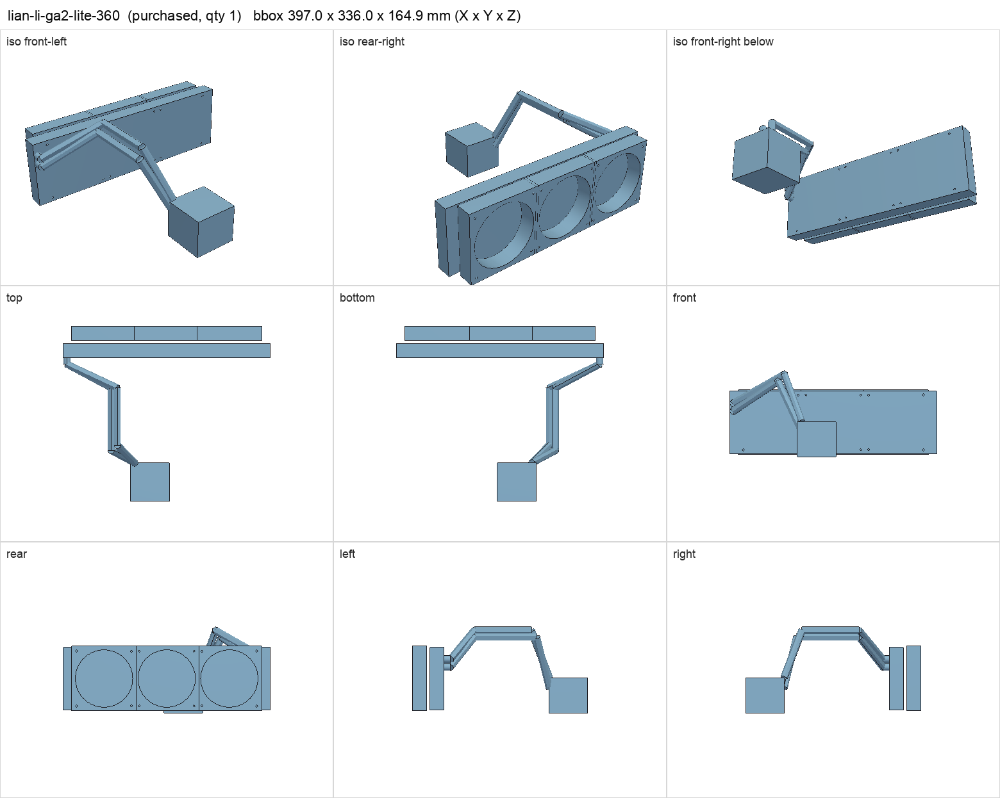
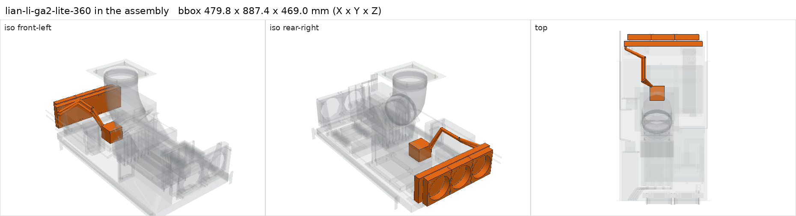

# Lian Li GA II LITE Performance 360 (GA2L36PB)

<!-- Generated by make check from part.toml. Edit part.toml, not this file. -->

| | |
| --- | --- |
| ID | `lian-li-ga2-lite-360` |
| Category | purchased |
| Role | Kenshin CPU cooler, rear of shelf |
| Status | owned |
| Quantity | 1 |
| Systems | kenshin |

Pump position and hose ports are survey assumptions; the radiator mounting pitch is the 120 mm fan standard.

## Model

- [lian-li-ga2-lite-360.step](lian-li-ga2-lite-360.step)
- Source: constructed
- Assembly: 13 instances in the assembly

## Datasheets

- [Lian Li GA II LITE product page](https://lian-li.com/product/ga-ii-lite/)
- Local copies: `datasheets/` after `make datasheets` (not committed)

## Dimensions

| Key | Value | Evidence | Source / note |
| --- | --- | --- | --- |
| radiator_length | 397 mm | datasheet | Lian Li 397 x 120 x 27 |
| radiator_height | 120 mm | datasheet | Lian Li 397 x 120 x 27 |
| radiator_thickness | 27 mm | datasheet | Lian Li 397 x 120 x 27 |
| fan_width | 124 mm | datasheet | Lian Li 124 x 120 x 28 fan (PB SKU); axis of the 124 mm not stated; at 120 mm pitch the modeled fans overlap 4 mm (allowed pair in shelf_layout.py). Measure the owned fans. |
| fan_depth | 28 mm | datasheet | Lian Li 124 x 120 x 28 fan |
| tube_length | 400 mm | datasheet | Lian Li |
| fan_envelope_height | 124 mm | allowance | 120 mm fan plus 2 mm side-connector allowance each way |
| hole_pitch | 105 mm | standard | 120 mm fan hole pattern |
| mass | 1.6 kg | assumed |  |

## Interfaces

- provides `cooler-mount` accepts ['AM5', 'AM4', 'LGA1700', 'LGA1851'] (datasheet)
- requires `radiator-mount` value 360 mm, 105 mm pitch count 2 (datasheet)
- requires `dc-power` load 15 (assumed)

## Compatibility checks

| Status | Rule | Interface | Detail |
| --- | --- | --- | --- |
| provisional | budget | `dc-power` | load 908.0 W of 1200.0 W x derate 0.8 = 960.0 W (76% of rating) |
| provisional | value | `radiator-mount` | lian-li-ga2-lite-360 needs 360 mm, 105 mm pitch; provided by fan120_aio_frame |
| provisional | count | `radiator-mount` | need 2 x radiator-mount=360 mm, 105 mm pitch, have 2 |
| provisional | budget | `shelf-load` | load 23.3 kg of 39.0 kg x derate 1.0 = 39.0 kg (60% of rating) |
| pass | value | `cooler-mount` | amd-ryzen-9-9950x3d needs AM5; provided by lian-li-ga2-lite-360 |

