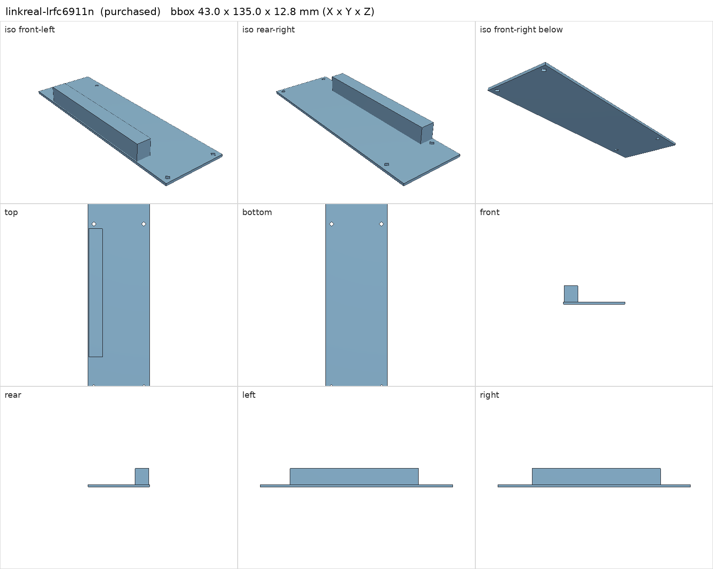

# Linkreal (LR-Link) LRFC6911N, 1 x SFF-8643 to PCIe x16 slot (x4) adapter

<!-- Generated by make check from part.toml. Edit part.toml, not this file. -->

| | |
| --- | --- |
| ID | `linkreal-lrfc6911n` |
| Category | purchased |
| Product | <https://lr-link.com/products/lrfc6911.html> |
| Listing | <https://www.newegg.com/p/17Z-00TX-000C5> |

Chosen 2026-11-10, to be bought from Newegg (about $26, ships from China); not
ordered yet. It replaces the Delock 64173 candidate: that riser was listed as
PCIe 4.0 but was on backorder at the only US seller found, and the ConnectX-4
Lx is PCIe 3.0, so a Gen3 board is enough.
LR-Link does not state a PCIe generation; the Newegg Business listing of the
same 6911 board says PCIe 3.0 x4. Power is a SATA 15-pin socket, which leaves
the Hercules's Molex leads for the fan harness.
The LR-Link spec table gives 121 x 114.10 mm and 45.5 g; a search summary
quoting 120 x 42 mm did not match the page. Measure the board and its hole
positions on arrival before designing the holder.
The board has no bracket. It needs a printed holder and a place on the shelf,
and the NIC on it needs 300 LFM.
Layout from the LR-Link product photo (scaled to the 121 mm length): the x16
slot runs along one long edge, starting about 24 mm from the end that carries
the power circuitry (the slot key is at that end, so a card's bracket sits
there); the SATA power and SFF-8643 sockets sit on the opposite long edge and
mate in the board plane. The photographed board is about 43.5 mm wide, not
the 114.10 mm the spec table gives; the photo-estimated dims below drive the
AIPC holder and must be measured on arrival.
Owner, 2026-11-19, with the board in hand: the mounting holes are about
35 x 114 mm centre to centre, and the SATA power socket is not on the long
edge as the vendor photo suggested. It sits on the underside at the end
opposite the power circuitry, about 5 mm deep, and mates along the board
length from that end. The socket is 32 mm wide and 12.5 mm deep along the
board, and the board is 135 x 43 mm (owner). Scaled to the measured hole
pitch, the owner's underside photo puts the SATA-end holes about 18 mm in
from that end, past the socket.
Owner, 2026-11-27, with the riser fitted: the SFF-8643 plug lies along the
top of the board at the socket edge, its pull tab and cable pointing toward
the SATA end, so the plug does not project past the board edge.

## Used in

| Build | Qty | Status | Role |
| --- | ---: | --- | --- |
| [aipc](../../../aipc/parts/linkreal-lrfc6911n.md) | 1 | selected | Berserk NIC slot: takes an H12D-8D SFF-8643 PCIe x4 port and provides an x16 slot for the ConnectX; lies flat in the printed berserk_nic_holder beside Kenshin's side AIO |

## Model

- [linkreal-lrfc6911n.step](linkreal-lrfc6911n.step)
- Source: constructed
- Written by the `aipc` build's generator

## Datasheets

- [LR-Link LRFC6911 product page](https://lr-link.com/products/lrfc6911.html)
- Local copies: `datasheets/` after `make datasheets` (not committed)

## Dimensions

| Key | Value | Evidence | Source / note |
| --- | --- | --- | --- |
| length | 121 mm | datasheet | LR-Link spec table: Dimensions 121mm*114.10mm |
| width | 114.1 mm | datasheet | LR-Link spec table: Dimensions 121mm*114.10mm |
| mass | 0.0455 kg | datasheet | LR-Link spec table: Weight 45.5g |
| pcb_length | 135 mm | measured | owner, 2026-11-19; the LR-Link spec table's 121 mm does not match the board |
| pcb_width | 43 mm | measured | owner, 2026-11-19; the spec table's 114.10 mm does not match the board |
| pcb_thickness | 1.6 mm | assumed |  |
| hole_diameter | 3.2 mm | assumed |  |
| hole_inset_end | 3.2 mm | photo-estimate | owner underside photo 2026-11-19, scaled to the 114 mm pitch; hole centre from the power-circuit end (the SATA-end holes sit about 18 mm in, past the socket) |
| hole_pitch_length | 114 mm | measured | owner, 2026-11-19: about 114 mm centre to centre along the board |
| hole_inset_slot_edge | 4 mm | photo-estimate | holes assumed centred on the measured 43 mm width: (43 - 35) / 2 |
| hole_pitch_width | 35 mm | measured | owner, 2026-11-19: about 35 mm centre to centre across the board |
| slot_start | 24 mm | photo-estimate | product photo; x16 slot key end from the power-circuit end |
| slot_length | 90 mm | photo-estimate | product photo |
| slot_center_from_edge | 5.3 mm | photo-estimate | product photo; slot centreline from the board edge |
| slot_width | 9.5 mm | photo-estimate | product photo |
| slot_height | 11.25 mm | assumed | typical x16 connector height above the PCB |
| sata_length_along_board | 12.5 mm | measured | owner, 2026-11-19: socket depth from the SATA end of the board |
| sata_width | 32 mm | measured | owner, 2026-11-19 |
| sata_center_from_slot_edge | 21.5 mm | photo-estimate | owner underside photo 2026-11-19: centred on the board width |
| sata_underside_depth | 5 mm | measured | owner, 2026-11-19: SATA power socket stands about 5 mm below the board |
| sff_start | 57.2 mm | photo-estimate | product photo; SFF-8643 socket span from the power-circuit end |
| sff_end | 73.9 mm | photo-estimate | product photo |
| sata_plug_projection | 20 mm | allowance | straight SATA power plug and cable bend past the board end; the socket mates along the board length |

## Interfaces

- provides `sff-8643-port` value PCIe x4 device count 1 (listing) — LR-Link: Mini-SAS HD 4i socket connector (SFF-8643)
- provides `pcie-x4-slot` value PCIe x8 card, x4 link count 1 (listing) — LR-Link: 1*PCIe X16 Slot (X4 Bandwidth); LR-Link lists network cards among supported devices
- requires `sata-power` count 1 (listing) — LR-Link: 1x SATA 15 Pin Power Interface, 12V & 3.3V 5A; feeds the slot's 12 V and 3.3 V for the NIC

