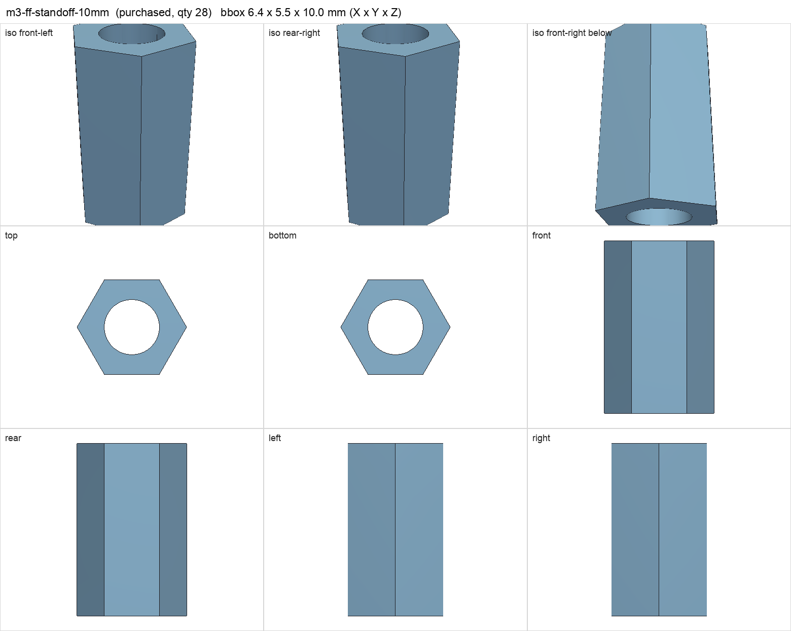

# M3 x 10 mm female/female hex standoff, SW5.5

<!-- Generated by make check from part.toml. Edit part.toml, not this file. -->

| | |
| --- | --- |
| ID | `m3-ff-standoff-10mm` |
| Category | purchased |

Puts the riser PCB top at 6 + 10 + 1.6 = 17.6 mm above the deck, 0.475 mm above
the AIPC H12D PCB height the OBT posts were surveyed for. Check the bracket seats
on the post with the card fully inserted.

## Used in

| Build | Qty | Status | Role |
| --- | ---: | --- | --- |
| [gpulab](../../../gpulab/parts/m3-ff-standoff-10mm.md) | 28 | candidate | riser board standoffs on the baseboard nut channels |

## Model

- [m3-ff-standoff-10mm.step](m3-ff-standoff-10mm.step)
- Source: constructed
- Written by the `gpulab` build's generator

## Datasheets

- None recorded. Generic hardware; pick a brand (for example a Wurth WA-SSTII M3 F/F 10 mm) and record its drawing.

## Dimensions

| Key | Value | Evidence | Source / note |
| --- | --- | --- | --- |
| length | 10 mm | allowance |  |
| across_flats | 5.5 mm | allowance |  |
| mass | 0.002 kg | assumed |  |

## Interfaces

- provides `riser-standoff` value M3 F/F 10 mm count 1 (allowance)

