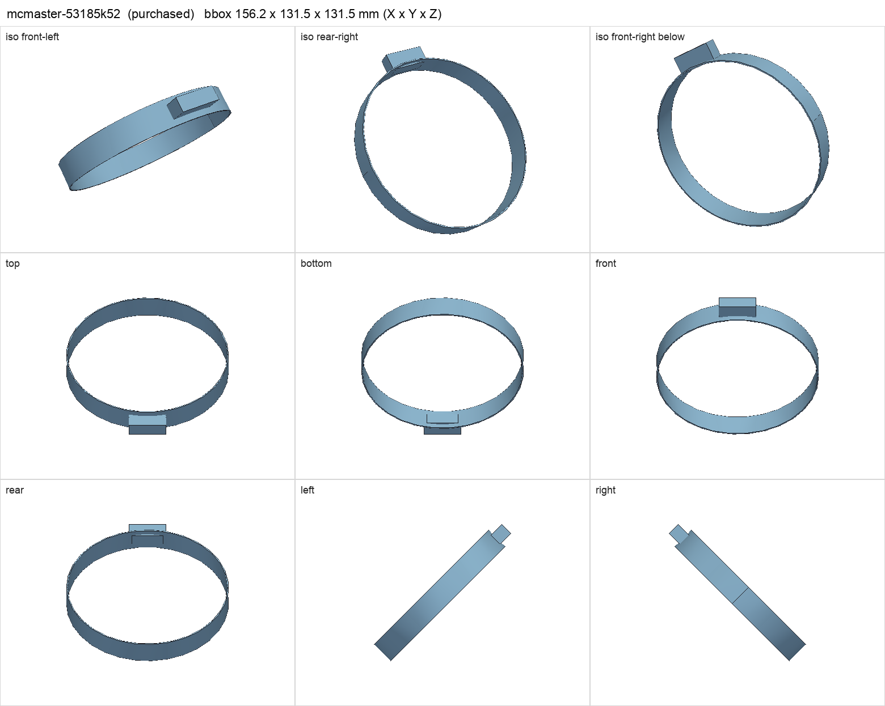

# McMaster-Carr 53185K52 lever-release hose clamp

<!-- Generated by make check from part.toml. Edit part.toml, not this file. -->

| | |
| --- | --- |
| ID | `mcmaster-53185k52` |
| Category | purchased |

## Used in

| Build | Qty | Status | Role |
| --- | ---: | --- | --- |
| [aipc](../../../aipc/parts/mcmaster-53185k52.md) | 2 | selected | duct clamps |

## Model

- [mcmaster-53185k52.step](mcmaster-53185k52.step)
- Source: constructed
- Written by the `aipc` build's generator

## Datasheets

- [McMaster-Carr 53185K52](https://www.mcmaster.com/53185K52/)
- Local copies: `datasheets/` after `make datasheets` (not committed)

