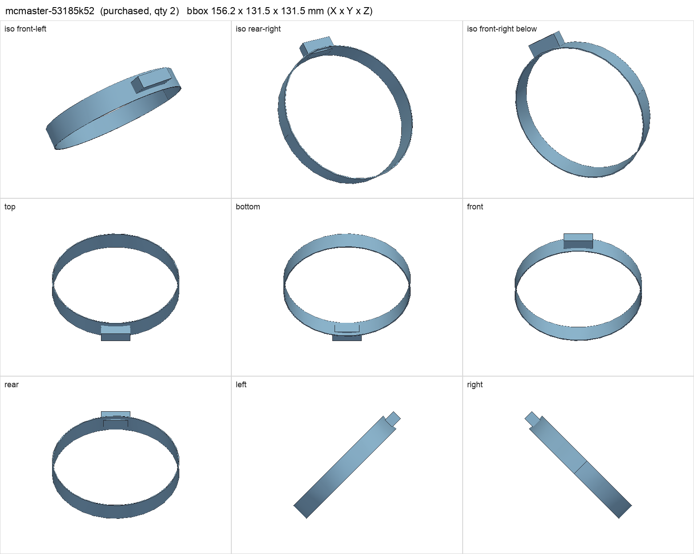
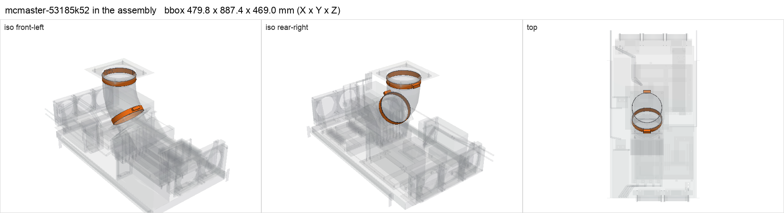

# McMaster-Carr 53185K52 lever-release hose clamp

<!-- Generated by make check from part.toml. Edit part.toml, not this file. -->

| | |
| --- | --- |
| ID | `mcmaster-53185k52` |
| Category | purchased |
| Role | duct clamps |
| Status | selected |
| Quantity | 2 |
| Systems | berserk |

## Model

- [mcmaster-53185k52.step](mcmaster-53185k52.step)
- Source: constructed
- Assembly: 2 instances in the assembly

## Datasheets

- [McMaster-Carr 53185K52](https://www.mcmaster.com/53185K52/)
- Local copies: `datasheets/` after `make datasheets` (not committed)

