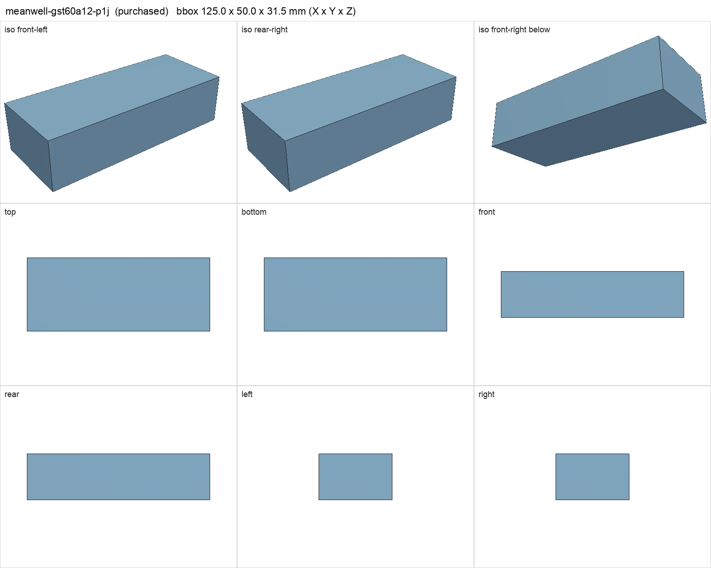

# Mean Well GST60A12-P1J 12 V 5 A desktop adapter

<!-- Generated by make check from part.toml. Edit part.toml, not this file. -->

| | |
| --- | --- |
| ID | `meanwell-gst60a12-p1j` |
| Category | purchased |

Fully enclosed adapter, so no exposed mains wiring in the rack. IEC320-C14 inlet
(any C13 cord or PDU outlet), 1000 mm UL1185 16 AWG output cable with a P1J plug:
5.5 mm outer, 2.1 mm inner, centre positive, -V not connected to AC earth.
Protections: short circuit, overload, over-voltage and over-temperature.

## Used in

| Build | Qty | Status | Role |
| --- | ---: | --- | --- |
| [rack](../../../rack/parts/meanwell-gst60a12-p1j.md) | 1 | selected | 12 V supply for the fans and the controller, plugged into the rack PDU |

## Model

- [meanwell-gst60a12-p1j.step](meanwell-gst60a12-p1j.step)
- Source: constructed. Case envelope only.
- Written by the `rack` build's generator

## Datasheets

- [Mean Well GST60A series specification (GST60A-SPEC 2026-04-03)](https://www.meanwell.com/Upload/PDF/GST60A/GST60A-SPEC.PDF)
- Local copies: `datasheets/` after `make datasheets` (not committed)

## Dimensions

| Key | Value | Evidence | Source / note |
| --- | --- | --- | --- |
| length | 125 mm | datasheet | GST60A-SPEC: 125 x 50 x 31.5 mm |
| width | 50 mm | datasheet | GST60A-SPEC: 125 x 50 x 31.5 mm |
| height | 31.5 mm | datasheet | GST60A-SPEC: 125 x 50 x 31.5 mm |
| output_voltage | 12 V | datasheet | GST60A-SPEC: 12 V +/-3% |
| rated_current | 5 A | datasheet | GST60A-SPEC |
| rated_power | 60 W | datasheet | GST60A-SPEC |
| efficiency | 0.895 None | datasheet | GST60A-SPEC: 89.5% typ. |
| output_cable_length | 1000 mm | datasheet | GST60A-SPEC: UL1185 16 AWG 1000 +/-50 mm for 12-15 V |
| mass | 0.305 kg | datasheet | GST60A-SPEC packing: 0.305 kg per unit |

## Interfaces

- provides `dc-12v` capacity 60 W (datasheet)
- provides `dc-barrel-5.5x2.1` value 12 V, 5.5 x 2.1 mm, centre positive count 1 (datasheet)
- requires `ac-power` load 67 W (datasheet) — 60 W rated output / 89.5% efficiency; the fans and controller draw about 11 W
- requires `ac-outlet-c13` count 1 (datasheet) — C13 outlet on the PDU, or a C13 cord to the wall

