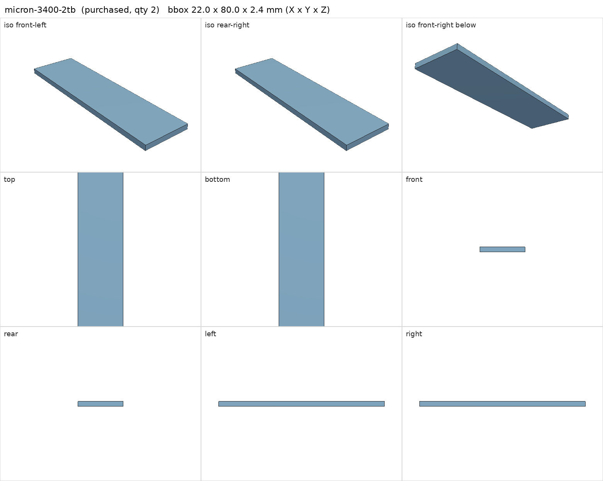
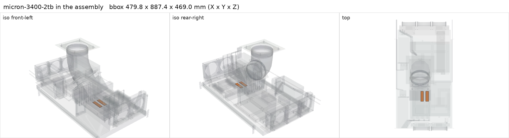

# Micron 3400 2 TB NVMe (MTFDKBA2T0TFH)

<!-- Generated by make check from part.toml. Edit part.toml, not this file. -->

| | |
| --- | --- |
| ID | `micron-3400-2tb` |
| Category | purchased |
| Role | Berserk model storage, two of the three RAID 0 members |
| Status | owned |
| Quantity | 2 |
| Systems | berserk |
| Listing | <https://www.ebay.com/itm/880020201442> |

Installed and in use since 2026-11-07. Ordered as three Dell OEM 3400s
(0VX5CD) from the eBay listing below; two 3400s and one Micron 3500
(micron-3500-2tb) arrived. Identity from the drives' NVMe identify data:
- MTFDKBA2T0TFH-1BC1AABHA, firmware HPS0043 (HP OEM firmware)
- "Micron 3400 NVMe 2048GB", firmware 34000060
Both link at PCIe 4.0 x4 (16 GT/s). Measured idle composite temperature about
50 C on the bare board, 58 C after a short write burst (warning thresholds
80 C and 83 C).
SMART 2026-11-07, both PASSED with 0% used, 100% spare and no media errors:
HPS0043 drive 93 power-on hours, 1.9 TB written; 34000060 drive 30 hours,
97 GB written.
The Mouser copy of the brief blocks automated download; save it by hand.

## Model

- [micron-3400-2tb.step](micron-3400-2tb.step)
- Source: constructed. 22 x 80 x 2.4 mm at the photo-estimated M.2 standoffs, beneath the V100s.
- Assembly: 2 instances in the assembly

## Datasheets

- [Micron 3400 SSD product brief (Mouser copy)](https://www.mouser.com/datasheet/2/671/Micron_Technology_micron_3400_ssd_product_brief-2499062.pdf)
- Local copies: `datasheets/` after `make datasheets` (not committed)

## Dimensions

| Key | Value | Evidence | Source / note |
| --- | --- | --- | --- |
| length | 80 mm | datasheet | product brief: M.2 (22 x 80mm) |
| width | 22 mm | datasheet | product brief: M.2 (22 x 80mm) |
| thickness | 2.4 mm | assumed | single-sided bare drive |
| mass | 0.008 kg | assumed |  |
| seq_read | 6600 MB/s | datasheet | product brief, 2TB column |
| seq_write | 5000 MB/s | datasheet | product brief, 2TB column |
| endurance | 1200 TBW | datasheet | product brief, 2TB column |

## Interfaces

- requires `m2-slot` value M.2 2280 NVMe count 1 (listing)
- requires `dc-power` load 8.25 (measured) — NVMe power state 0 maximum, read from both drives 2026-11-07; the brief gives <7.5 W Gen4 active read

## Compatibility checks

| Status | Rule | Interface | Detail |
| --- | --- | --- | --- |
| provisional | budget | `dc-power` | load 1096.0 W of 1600.0 W x derate 0.8 = 1280.0 W (68% of rating); relies on configured limits of ['nvidia-v100-pcie-16gb']; unlimited peak 1376.0 W |
| provisional | value | `m2-slot` | micron-3400-2tb needs M.2 2280 NVMe; provided by huananzhi-h12d-8d |
| provisional | count | `m2-slot` | need 3 x m2-slot=m.2 2280 nvme, have 3 |
| provisional | budget | `shelf-load` | load 23.7 kg of 39.0 kg x derate 1.0 = 39.0 kg (61% of rating) |

