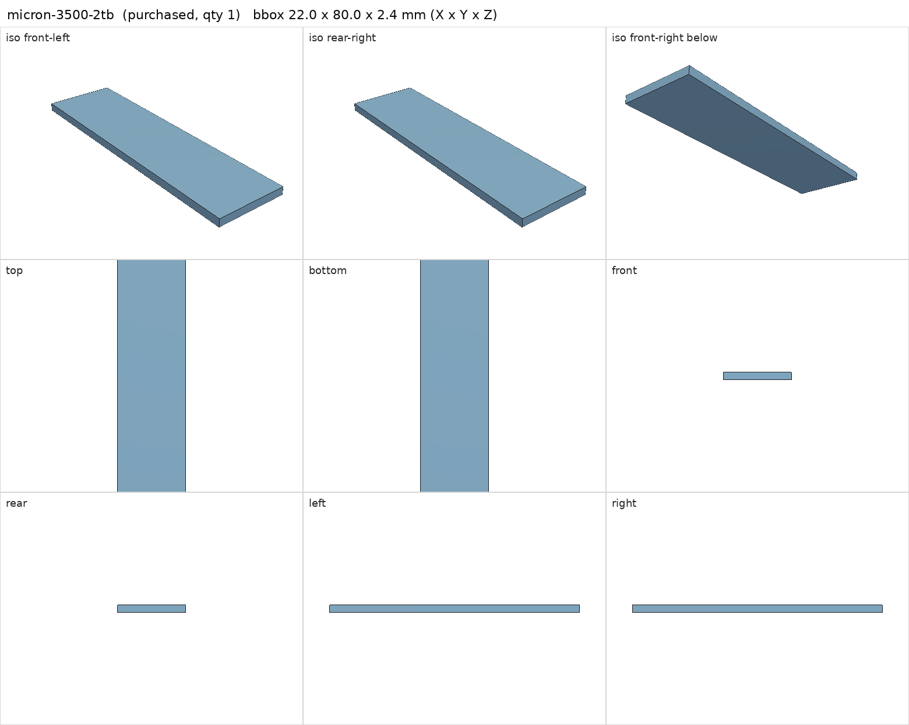
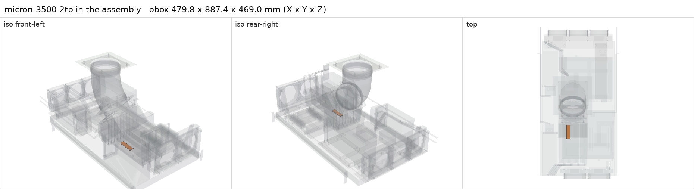

# Micron 3500 2 TB NVMe (MTFDKBA2T0TGD)

<!-- Generated by make check from part.toml. Edit part.toml, not this file. -->

| | |
| --- | --- |
| ID | `micron-3500-2tb` |
| Category | purchased |
| Role | Berserk model storage, one of the three RAID 0 members |
| Status | owned |
| Quantity | 1 |
| Systems | berserk |
| Listing | <https://www.ebay.com/itm/880020201442> |

Installed and in use since 2026-11-07. Arrived in the order for three Dell
Micron 3400s from the eBay listing below in place of one 3400. Identity from
the drive's NVMe identify data: MTFDKBA2T0TGD-1BK1AABHA, firmware HPS0050
(HP OEM firmware). Links at PCIe 4.0 x4 (16 GT/s). Measured idle composite
temperature about 39 C on the bare board, about 15 C cooler than the 3400s
(warning threshold 86 C).
SMART 2026-11-07: PASSED, 0% used, 100% spare, no media errors, 559 power-on
hours, 6.4 TB written.
Which M.2 slot holds it is not recorded; the assembly puts it in slot 3.
The Arrow copy of the brief blocks automated download; save it by hand.

## Model

- [micron-3500-2tb.step](micron-3500-2tb.step)
- Source: constructed. 22 x 80 x 2.4 mm at the photo-estimated M.2 standoffs, beneath the V100s.
- Assembly: 1 instances in the assembly

## Datasheets

- [Micron 3500 NVMe SSD product brief (Arrow copy)](https://static6.arrow.com/aropdfconversion/2547cff09287eb6bd4dacd83d5c50d725f96917/3500-nvme-ssd-product-brief.pdf)
- Local copies: `datasheets/` after `make datasheets` (not committed)

## Dimensions

| Key | Value | Evidence | Source / note |
| --- | --- | --- | --- |
| length | 80 mm | standard | M.2 2280 |
| width | 22 mm | standard | M.2 2280 |
| thickness | 2.4 mm | assumed | single-sided bare drive |
| mass | 0.008 kg | assumed |  |

## Interfaces

- requires `m2-slot` value M.2 2280 NVMe count 1 (listing)
- requires `dc-power` load 8.25 (measured) — NVMe power state 0 maximum, read from the drive 2026-11-07

## Compatibility checks

| Status | Rule | Interface | Detail |
| --- | --- | --- | --- |
| provisional | budget | `dc-power` | load 1096.0 W of 1600.0 W x derate 0.8 = 1280.0 W (68% of rating); relies on configured limits of ['nvidia-v100-pcie-16gb']; unlimited peak 1376.0 W |
| provisional | value | `m2-slot` | micron-3500-2tb needs M.2 2280 NVMe; provided by huananzhi-h12d-8d |
| provisional | count | `m2-slot` | need 3 x m2-slot=m.2 2280 nvme, have 3 |
| provisional | budget | `shelf-load` | load 23.7 kg of 39.0 kg x derate 1.0 = 39.0 kg (61% of rating) |

