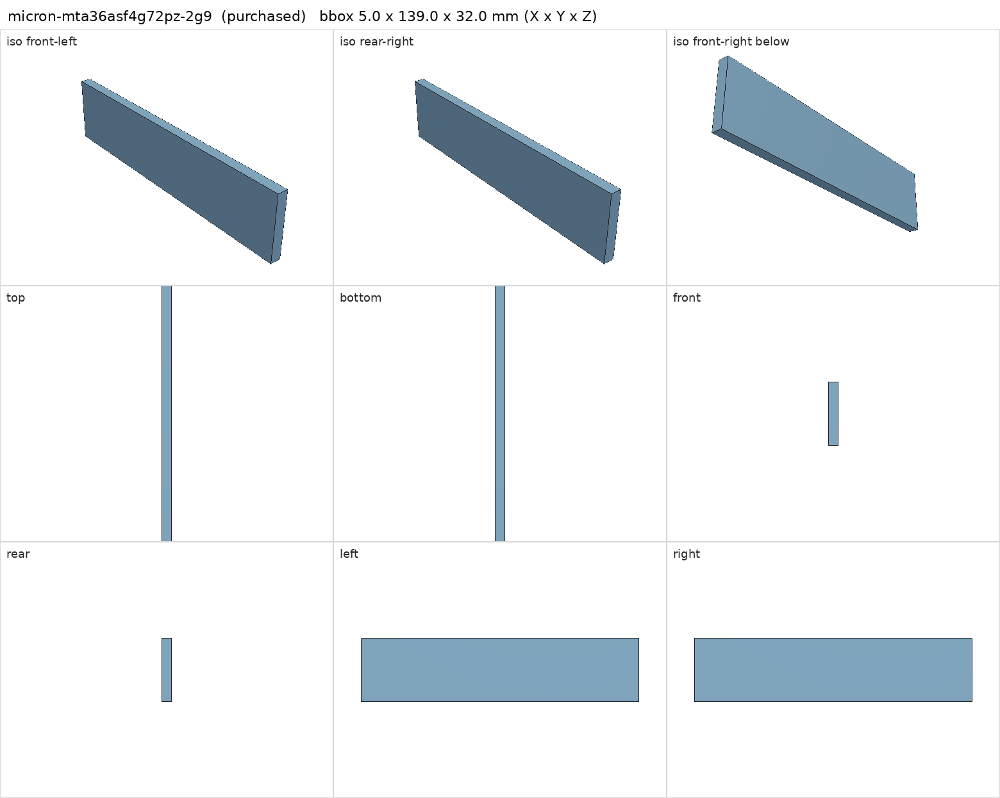

# Micron 32 GB DDR4-2933 ECC RDIMM (MTA36ASF4G72PZ-2G9E2UI)

<!-- Generated by make check from part.toml. Edit part.toml, not this file. -->

| | |
| --- | --- |
| ID | `micron-mta36asf4g72pz-2g9` |
| Category | purchased |
| Listing | <https://www.ebay.com/itm/377566838345> |

Ordered 2026-11-04 as a used matched kit, 2Rx4, 1.2 V. Installed 2026-11-07,
one DIMM per channel in MM1-MM8 (channels A-H). SPD reads Micron
36ASF4G72PZ-2G9E2, 32 GB, 2 ranks; all eight run at 2933 MT/s. ECC is active
(EDAC x4 chipkill mode) with no corrected or uncorrected errors at first boot.
A full memory test is still pending.

## Used in

| Build | Qty | Status | Role |
| --- | ---: | --- | --- |
| [aipc](../../../aipc/parts/micron-mta36asf4g72pz-2g9.md) | 8 | owned | Berserk memory, 8 x 32 GB |

## Model

- [micron-mta36asf4g72pz-2g9.step](micron-mta36asf4g72pz-2g9.step)
- Source: constructed. 5 x 139 x 32 mm module envelope at photo-estimated socket positions.
- Written by the `aipc` build's generator

## Datasheets

- [Micron DDR4 RDIMM product family (look up MTA36ASF4G72PZ)](https://www.micron.com/products/memory/dram-modules/rdimm)
- Local copies: `datasheets/` after `make datasheets` (not committed)

## Dimensions

| Key | Value | Evidence | Source / note |
| --- | --- | --- | --- |
| module_height | 32 mm | assumed | provisional installed height |
| mass | 0.04 kg | assumed |  |

## Interfaces

- requires `memory-slot` value DDR4 RDIMM count 1 (listing)
- requires `dc-power` load 5 (assumed)

