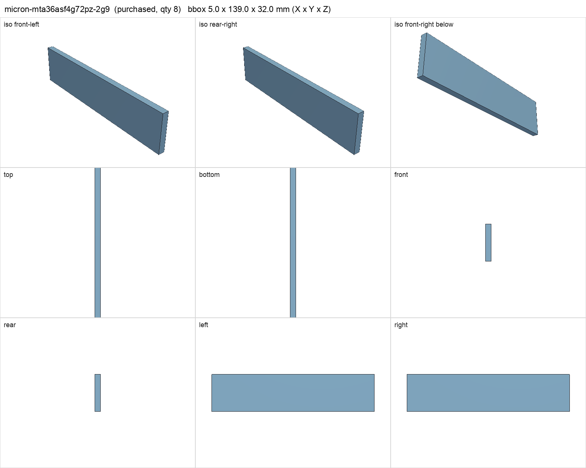
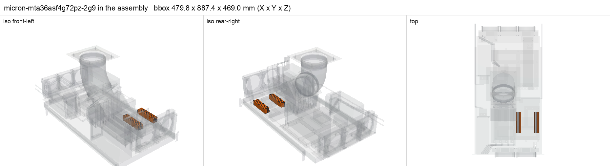

# Micron 32 GB DDR4-2933 ECC RDIMM (MTA36ASF4G72PZ-2G9E2UI)

<!-- Generated by make check from part.toml. Edit part.toml, not this file. -->

| | |
| --- | --- |
| ID | `micron-mta36asf4g72pz-2g9` |
| Category | purchased |
| Role | Berserk memory, 8 x 32 GB |
| Status | ordered |
| Quantity | 8 |
| Systems | berserk |
| Listing | <https://www.ebay.com/itm/377566838345> |

Ordered 2026-11-04 as a used matched kit, 2Rx4, 1.2 V. Receipt and memory test pending.

## Model

- [micron-mta36asf4g72pz-2g9.step](micron-mta36asf4g72pz-2g9.step)
- Source: constructed. 5 x 139 x 32 mm module envelope at photo-estimated socket positions.
- Assembly: 8 instances in the assembly

## Datasheets

- [Micron DDR4 RDIMM product family (look up MTA36ASF4G72PZ)](https://www.micron.com/products/memory/dram-modules/rdimm)
- Local copies: `datasheets/` after `make datasheets` (not committed)

## Dimensions

| Key | Value | Evidence | Source / note |
| --- | --- | --- | --- |
| module_height | 32 mm | assumed | provisional installed height |
| mass | 0.04 kg | assumed |  |

## Interfaces

- requires `memory-slot` value DDR4 RDIMM count 1 (listing)
- requires `dc-power` load 5 (assumed)

## Compatibility checks

| Status | Rule | Interface | Detail |
| --- | --- | --- | --- |
| BLOCKED | budget | `shelf-load` | load 23.1 kg of 39.0 kg x derate 1.0 = 39.0 kg (59% of rating); unknown load for ['fan-controller'] |
| provisional | budget | `dc-power` | load 1090.2 W of 1600.0 W x derate 0.8 = 1280.0 W (68% of rating); relies on configured limits of ['nvidia-v100-pcie-16gb']; unlimited peak 1370.2 W |
| provisional | value | `memory-slot` | micron-mta36asf4g72pz-2g9 needs DDR4 RDIMM; provided by huananzhi-h12d-8d |
| provisional | count | `memory-slot` | need 8 x memory-slot=ddr4 rdimm, have 8 |

