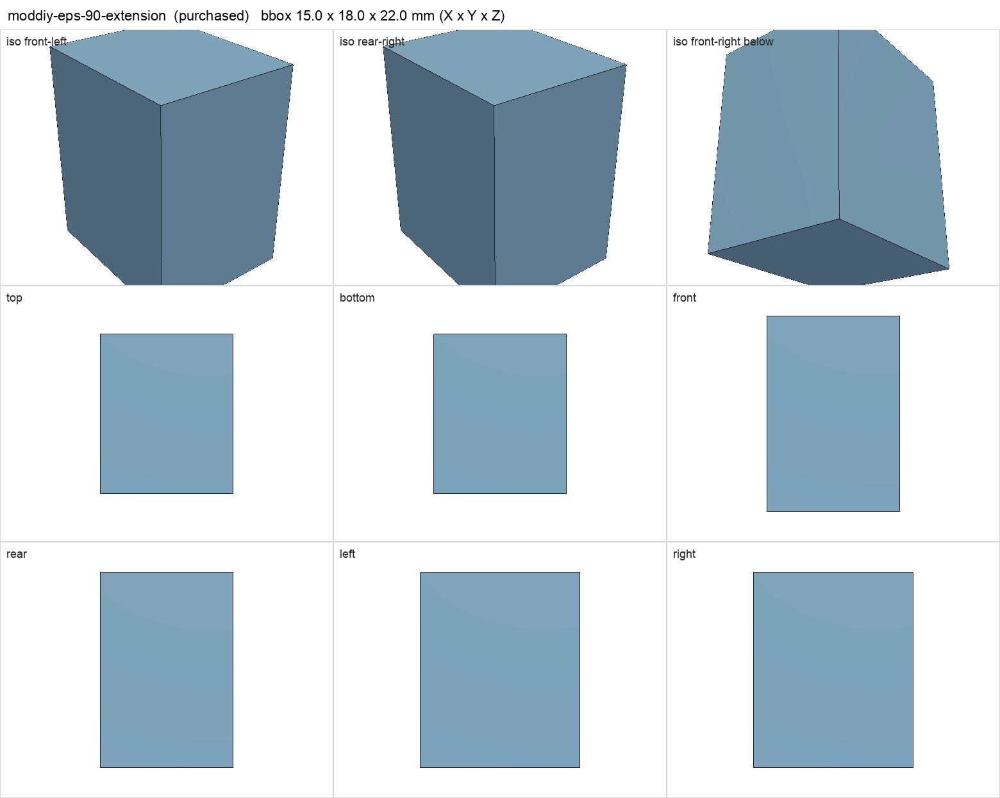

# Low-profile 90 degree CPU/EPS 8-pin extension

<!-- Generated by make check from part.toml. Edit part.toml, not this file. -->

| | |
| --- | --- |
| ID | `moddiy-eps-90-extension` |
| Category | purchased |

## Used in

- No build references this part.

## Model

- [moddiy-eps-90-extension.step](moddiy-eps-90-extension.step)
- Source: constructed. 15 x 18 x 22 mm plug target per card.

## Datasheets

- None recorded. MODDIY product page not recorded; the 18 mm projection is a design target, not a product dimension.

## Dimensions

| Key | Value | Evidence | Source / note |
| --- | --- | --- | --- |
| projection | 18 mm | allowance |  |
| mass | 0.02 kg | assumed |  |

