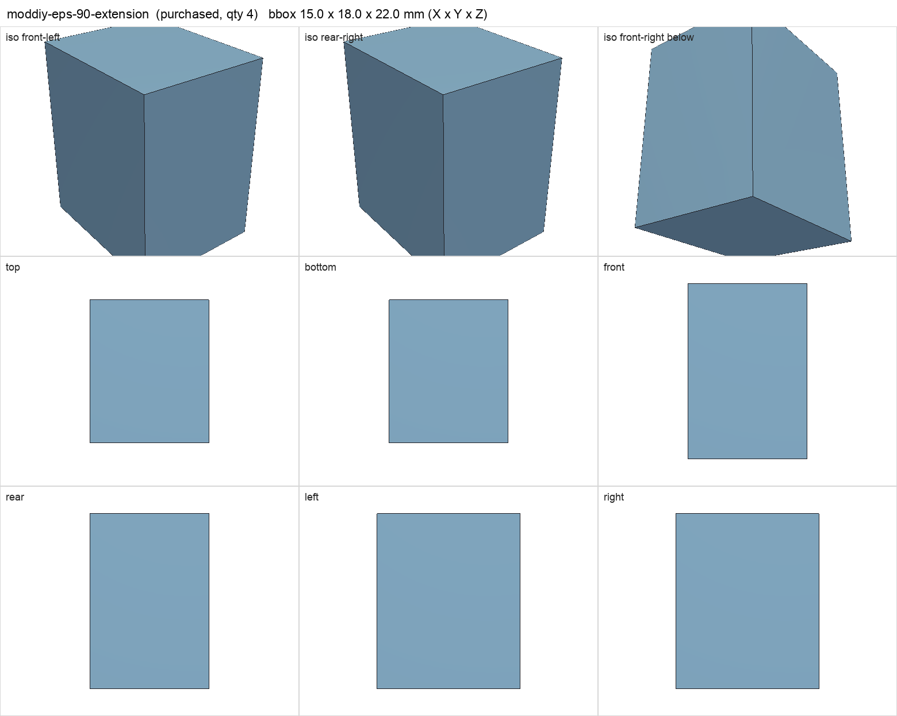
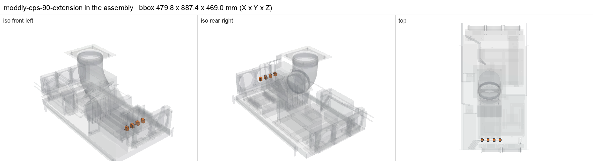

# Low-profile 90 degree CPU/EPS 8-pin extension

<!-- Generated by make check from part.toml. Edit part.toml, not this file. -->

| | |
| --- | --- |
| ID | `moddiy-eps-90-extension` |
| Category | purchased |
| Role | keeps V100 power plugs low and clear of the front radiator |
| Status | selected |
| Quantity | 4 |
| Systems | berserk |

## Model

- [moddiy-eps-90-extension.step](moddiy-eps-90-extension.step)
- Source: constructed. 15 x 18 x 22 mm plug target per card.
- Assembly: 4 instances in the assembly

## Datasheets

- None recorded. MODDIY product page not recorded; the 18 mm projection is a design target, not a product dimension.

## Dimensions

| Key | Value | Evidence | Source / note |
| --- | --- | --- | --- |
| projection | 18 mm | allowance |  |
| mass | 0.02 kg | assumed |  |

## Compatibility checks

| Status | Rule | Interface | Detail |
| --- | --- | --- | --- |
| BLOCKED | budget | `shelf-load` | load 23.1 kg of 39.0 kg x derate 1.0 = 39.0 kg (59% of rating); unknown load for ['fan-controller'] |

