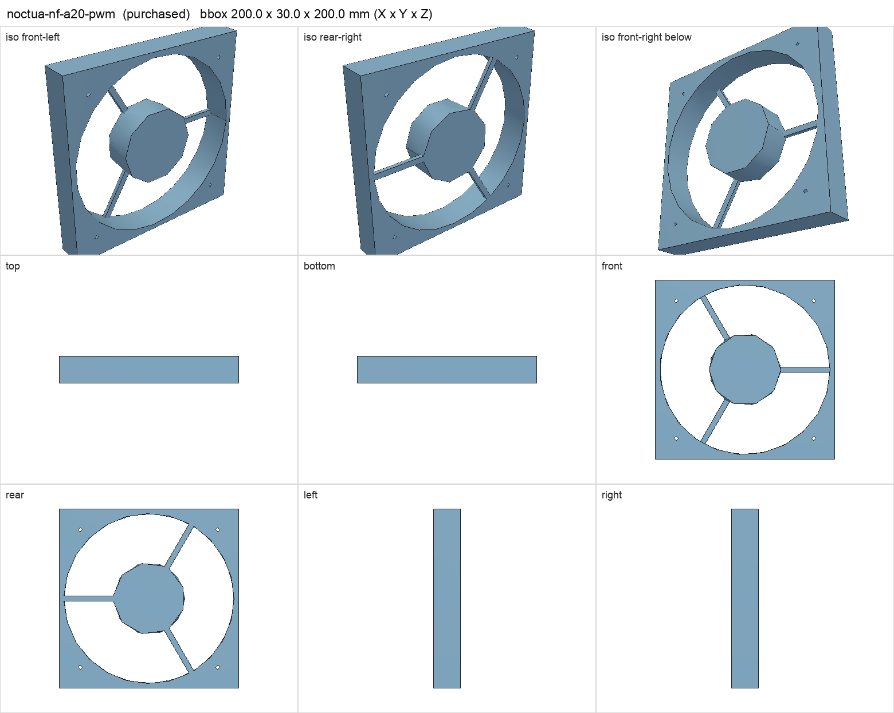

# Noctua NF-A20 PWM 200 x 30 mm fan

<!-- Generated by make check from part.toml. Edit part.toml, not this file. -->

| | |
| --- | --- |
| ID | `noctua-nf-a20-pwm` |
| Category | purchased |

12 V 4-pin PWM, 350-800 rpm, 146.9 m3/h (86.46 CFM) and 1.08 mm H2O at full speed,
18.1 dB(A). It never stops on PWM alone: 310 rpm at 20% PWM and 350 rpm at 0% PWM,
so a reading below about 150 rpm always means a stalled or unplugged fan.
Starting voltage 11 V; locked-rotor protection cuts power after 1 s and retries
every 2-6 s. Pin 1 GND, 2 +12 V, 3 tach, 4 PWM (Noctua's wire colours differ from
the usual black/yellow/green/blue order: check the pin, not the colour).
Ships with a 30 cm extension (500 mm reach in total), a Y splitter, the L.N.A.
(not used: the controller sets the speed), anti-vibration mounts and fan screws.
Mounting holes on three patterns; this build uses 154 x 154 mm.

## Used in

| Build | Qty | Status | Role |
| --- | ---: | --- | --- |
| [rack](../../../rack/parts/noctua-nf-a20-pwm.md) | 8 | selected | cabinet fans: four intake low at the front, four exhaust at the top rear or roof |

## Model

- [noctua-nf-a20-pwm.step](noctua-nf-a20-pwm.step)
- Source: constructed. Square frame envelope with the rotor area cut out; the bore diameter is not published, so the cut is illustrative.
- Written by the `rack` build's generator

## Datasheets

- [Noctua NF-A20 PWM specifications](https://www.noctua.at/en/products/nf-a20-pwm/specifications)
- [Noctua NF-A20 PWM datasheet](https://noctua.at/pub/media/blfa_files/infosheet/noctua_nf_a_20_pwm_datasheet_en_web.pdf)
- Local copies: `datasheets/` after `make datasheets` (not committed)

## Dimensions

| Key | Value | Evidence | Source / note |
| --- | --- | --- | --- |
| size | 200 mm | datasheet | Noctua specifications: 200 x 200 x 30 mm |
| depth | 30 mm | datasheet | Noctua specifications: 200 x 200 x 30 mm |
| depth_with_pads | 32 mm | datasheet | Noctua specifications: with anti-vibration pads |
| hole_pitch | 154 mm | datasheet | Noctua specifications: 170 x 170, 154 x 154, 110 x 180 mm |
| airflow_max | 86.46 CFM | datasheet | Noctua specifications: 146.9 m3/h |
| static_pressure_max | 1.08 mmH2O | datasheet | Noctua specifications |
| speed_max | 800 rpm | datasheet | Noctua specifications |
| speed_at_20pct_pwm | 310 rpm | datasheet | Noctua specifications |
| speed_at_0pct_pwm | 350 rpm | datasheet | Noctua specifications |
| noise_max | 18.1 dBA | datasheet | Noctua specifications |
| current_max | 0.08 A | datasheet | Noctua specifications: input current (max) |
| power_max | 0.96 W | datasheet | Noctua specifications: input power (max) |
| starting_voltage | 11 V | datasheet | Noctua specifications |
| cable_length | 200 mm | datasheet | Noctua specifications; 500 mm with the included extension |
| mass | 0.37 kg | datasheet | Noctua specifications: 370 g |

## Interfaces

- provides `cabinet-heat-removal` capacity 368.4 W (allowance) — free-air 86.46 CFM x 15 C rise / 1.76, halved because intake and exhaust fans run in series; derate 0.5 for grilles, guards and the equipment in the path. Not a measured cabinet airflow
- requires `fan-header-4pin` value 12 V 4-pin PWM count 1 (datasheet)
- requires `dc-12v` load 0.96 W (datasheet) — maximum input power
- requires `cabinet-fan-opening` value 200 mm fan, 154 mm hole pitch count 1 (datasheet) — cutout plus four screw holes in a cabinet panel

