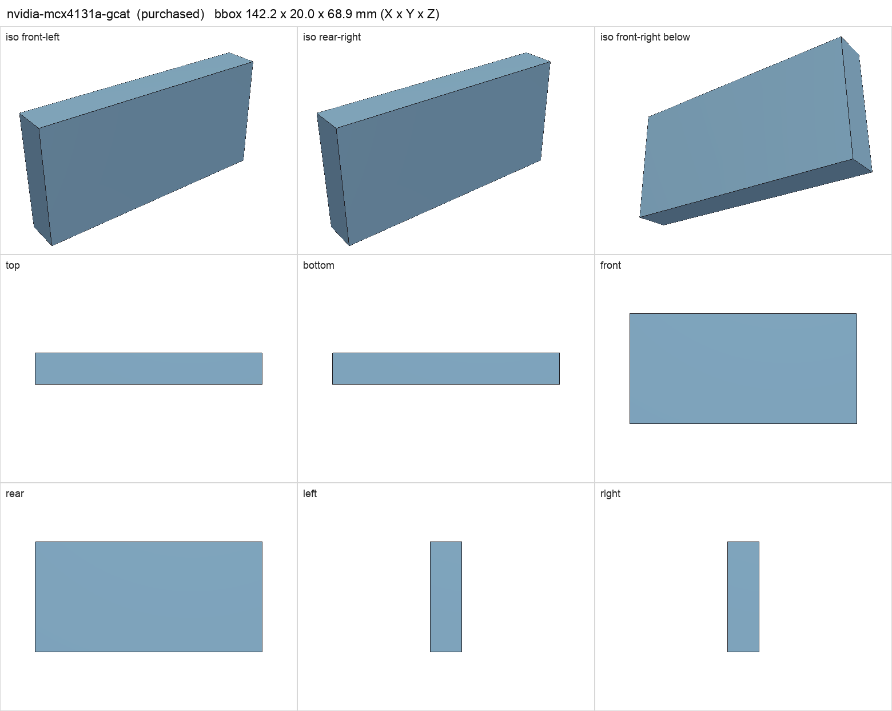

# NVIDIA (Mellanox) ConnectX-4 Lx EN MCX4131A-GCAT, 50GbE single-port QSFP28

<!-- Generated by make check from part.toml. Edit part.toml, not this file. -->

| | |
| --- | --- |
| ID | `nvidia-mcx4131a-gcat` |
| Category | purchased |
| Manual | <https://networking-docs.nvidia.com/connectx4lxhw/> |

Owned, two cards (owner, 2026-11-10); serial numbers and firmware not yet
recorded. Berserk's card carries a standard full-height bracket (owner,
2026-11-19). One goes in each PC, cabled directly with no switch.
PCIe 3.0 x8 card. Berserk has no free x16 slot (four V100s), so its card sits
in a Linkreal LRFC6911N riser fed from an H12D-8D SFF-8643 port (x4). Kenshin's
card goes in a chipset PCIEX4 slot (x4). Both links therefore train at
PCIe 3.0 x4 (about 31.5 Gb/s raw, roughly 25-28 Gb/s usable), below the
50GbE line rate.
Each card's systems entry covers both PCs, so the compatibility check lists
the NIC's power and slot rules as a separate group from each system's other
loads. Kenshin's PCIEX4 slots may sit under the RTX 5090 cooler; check that
before relying on them.
The card has a passive heatsink and needs 300 LFM across it (manual airflow
table). Neither placement has forced airflow yet.
NVIDIA lists the ConnectX-4 Lx line as end of life.

## Used in

| Build | Qty | Status | Role |
| --- | ---: | --- | --- |
| [aipc](../../../aipc/parts/nvidia-mcx4131a-gcat.md) | 2 | owned | Direct Berserk-Kenshin link over a QSFP28 DAC (one card per system) |

## Model

- [nvidia-mcx4131a-gcat.step](nvidia-mcx4131a-gcat.step)
- Source: constructed
- Written by the `aipc` build's generator

## Datasheets

- [ConnectX-4 Lx Ethernet adapter cards user manual: specifications](https://networking-docs.nvidia.com/connectx4lxhw/specifications)
- Local copies: `datasheets/` after `make datasheets` (not committed)

## Dimensions

| Key | Value | Evidence | Source / note |
| --- | --- | --- | --- |
| card_height | 68.9 mm | datasheet | manual specifications: 2.71 in. x 5.6 in. (68.90mm x 142.24 mm) - low profile |
| card_length | 142.24 mm | datasheet | manual specifications: 2.71 in. x 5.6 in. (68.90mm x 142.24 mm) - low profile |
| power_typical | 9.6 W | datasheet | manual specifications: typical power, passive cables |
| power_max | 11.6 W | datasheet | manual specifications: maximum power, passive cables |
| airflow | 300 LFM | datasheet | manual airflow table, 40/50Gb/s, passive cable, either direction |
| mass | 0.15 kg | assumed |  |
| pcb_thickness | 1.57 mm | standard | PCIe CEM nominal add-in card thickness |
| primary_side_height | 14.47 mm | standard | PCIe CEM single-slot primary-side component height limit |
| secondary_side_height | 2.67 mm | standard | PCIe CEM secondary-side component height limit |
| bracket_to_slot_start | 45 mm | allowance | PCIe CEM 2.0 Fig. 6-2: bracket outside face 59.05 mm from the connector key, less about 14 mm from the key to the slot housing end (assumed); bracket outer face to the slot key end; measure |
| bracket_height | 120.02 mm | standard | PCIe CEM full-height bracket; owner 2026-11-19: the card carries a standard full-height bracket |
| qsfp_cage_height | 40 mm | assumed | QSFP28 cage centre above the card's lower edge; measure |
| qsfp_cage_offset_from_pcb | 5.7 mm | assumed | cage centre from the PCB plane, component side |

## Interfaces

- provides `qsfp28-port` value QSFP28 50GbE count 1 (datasheet) — manual: Single QSFP28 (copper and optical); 50G-R2 and 50GBASE-R4 listed
- requires `pcie-x4-slot` value PCIe x8 card, x4 link count 1 (datasheet) — x8 edge connector, PCIe 3.0 8 GT/s; needs an open-ended or x16 physical slot; x4 electrical trains at x4
- requires `qsfp28-dac` value QSFP28 passive DAC, 50GbE count 1 (allowance) — one cable end per card; a passive DAC keeps power at the 11.6 W figure. Cable not chosen; length depends on where the two cards end up
- requires `pcie-card-airflow` value 300 (datasheet) — 300 LFM over the heatsink with passive cables; nothing in either system is specified to provide it yet
- requires `dc-power` load 11.6 W (datasheet) — maximum with passive cables, 12 V and 3.3 V; Berserk's comes through the riser

