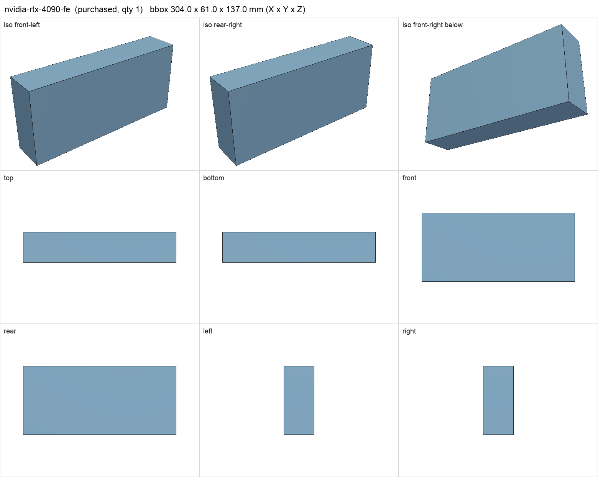

# NVIDIA GeForce RTX 4090 Founders Edition

<!-- Generated by make check from part.toml. Edit part.toml, not this file. -->

| | |
| --- | --- |
| ID | `nvidia-rtx-4090-fe` |
| Category | purchased |
| Product | <https://www.nvidia.com/en-us/geforce/graphics-cards/40-series/rtx-4090/> |

Same flow-through layout as the 3090 FE.
Occupies 4 positions (thickness plus 15-25 mm air gap at the 20.32 mm pitch).
Running on an MCIO riser at x8; values marked review/listing are provisional.

## Used in

| Build | Qty | Status | Role |
| --- | ---: | --- | --- |
| [gpulab](../../../gpulab/parts/nvidia-rtx-4090-fe.md) | 1 | candidate | GPU under test (flow-through cooler), 4 baseboard positions |

## Model

- [nvidia-rtx-4090-fe.step](nvidia-rtx-4090-fe.step)
- Source: constructed. Body envelope only: length x height x thickness.
- Written by the `gpulab` build's generator

## Datasheets

- [NVIDIA RTX 4090 specifications](https://www.nvidia.com/en-us/geforce/graphics-cards/40-series/rtx-4090/)
- Local copies: `datasheets/` after `make datasheets` (not committed)

## Dimensions

| Key | Value | Evidence | Source / note |
| --- | --- | --- | --- |
| length | 304 mm | datasheet | NVIDIA spec page |
| height | 137 mm | datasheet | NVIDIA spec page; KitGuru measured 147 mm |
| thickness | 61 mm | datasheet | NVIDIA spec page |
| tgp | 450 W | datasheet | NVIDIA spec page |
| mass | 2.19 kg | review | reviews 2.186 kg; Puget lists 2.254 kg |
| power_connector_from_tail | 125 mm | allowance | 16-pin on the top edge, from product photos; 0 means on the tail end. Not measured |

## Interfaces

- requires `riser-x16-slot` value PCIe x16 count 1 (datasheet) — PCIe 4.0 x16 card on an x8 riser link
- requires `gpu-baseboard-position` count 4 (allowance)
- requires `12v-2x6` count 1 (datasheet) — 16-pin 12VHPWR; a 12V-2x6 cable fits
- requires `dc-power` load 450 load_limited 320 (datasheet) — stock board power, including the 75 W slot power drawn through the riser; capped to 320 W for the 2800 W PSU budget: nvidia-smi -i <gpu> -pl 320, set at boot and confirm the driver accepts it

