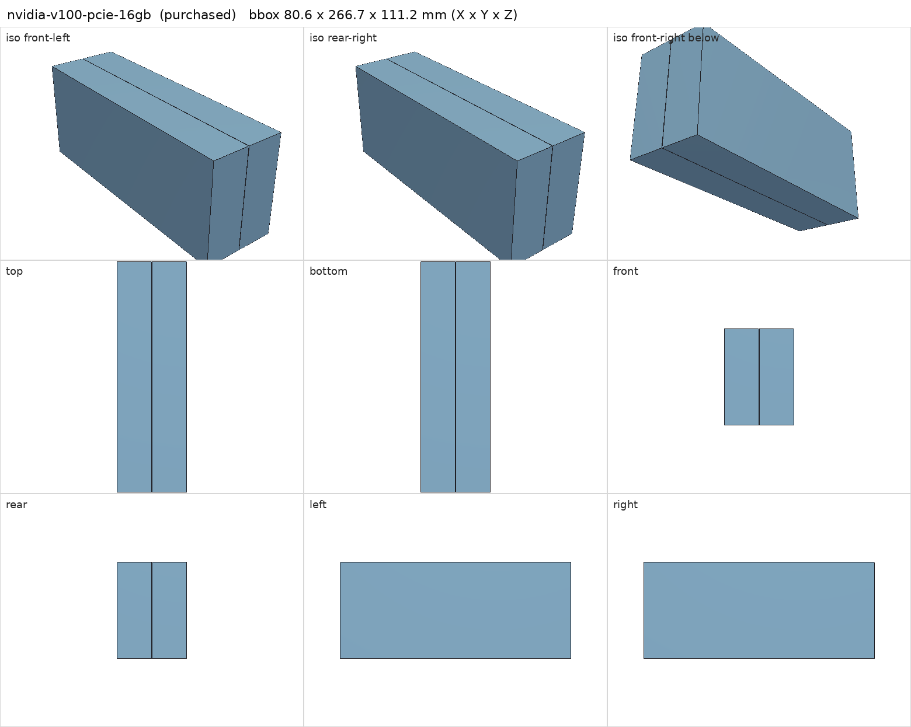

# NVIDIA Tesla V100 PCIe 16 GB

<!-- Generated by make check from part.toml. Edit part.toml, not this file. -->

| | |
| --- | --- |
| ID | `nvidia-v100-pcie-16gb` |
| Category | purchased |
| Listing | <https://www.ebay.com/itm/127840399241> |

Passive 250 W cards: they need forced ducted airflow. Auxiliary power is a
CPU/EPS 8-pin connector; never plug PCIe 8-pin into it. Start near 180 W per
card. Thickness, slot offset and flange holes are provisional.

## Used in

- No build references this part.

## Model

- [nvidia-v100-pcie-16gb.step](nvidia-v100-pcie-16gb.step)
- Source: constructed. Body envelope plus bracket-flange hole survey.

## Datasheets

- [Tesla V100 PCIe product brief](https://www.nvidia.com/content/dam/en-zz/Solutions/Data-Center/tesla-product-literature/Tesla-V100-PCIe-Product-Brief.pdf)
- Local copies: `datasheets/` after `make datasheets` (not committed)

## Dimensions

| Key | Value | Evidence | Source / note |
| --- | --- | --- | --- |
| length | 266.7 mm | datasheet | product brief |
| height | 111.15 mm | datasheet | product brief |
| thickness | 40 mm | allowance | dual-slot nominal; 36 mm component side + 4 mm back side assumed |
| tgp | 250 W | datasheet | product brief |
| mass | 1.196 kg | datasheet | product brief p.3, board 1196 g |

## Interfaces

- requires `pcie-x16-slot` value PCIe x16 count 1 (datasheet) — PCIe 3.0 card in a PCIe 4.0 slot
- requires `pcie-card-envelope` value 40 (allowance)
- requires `v100-aux-power` value CPU/EPS 8-pin count 1 (datasheet)
- requires `gpu-forced-airflow` count 1 (datasheet)
- requires `dc-power` load 250 load_limited 180 (datasheet) — nvidia-smi power limit 180 W planned for first runs

