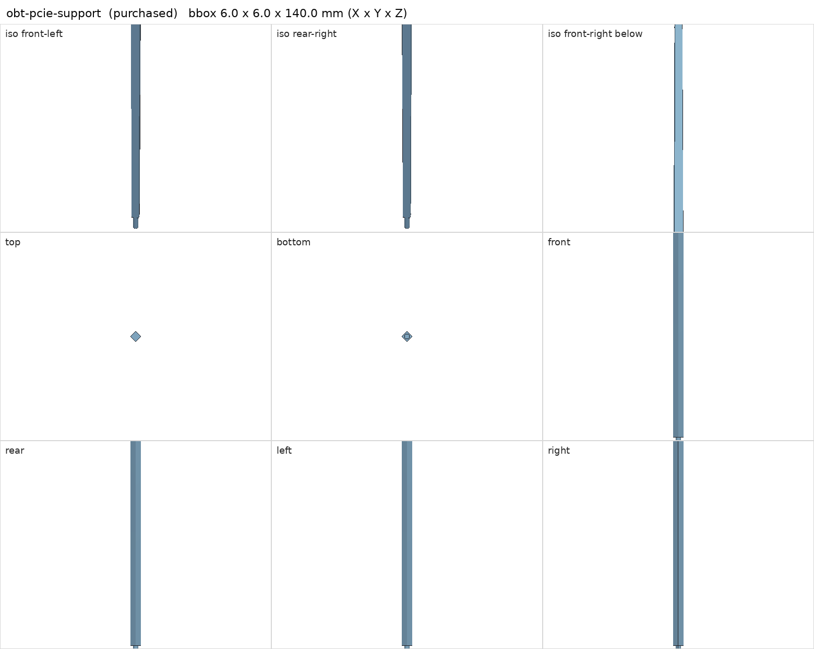

# Open Benchtable PCI-E support rod with nut

<!-- Generated by make check from part.toml. Edit part.toml, not this file. -->

| | |
| --- | --- |
| ID | `obt-pcie-support` |
| Category | purchased |

## Used in

| Build | Qty | Status | Role |
| --- | ---: | --- | --- |
| [aipc](../../../aipc/parts/obt-pcie-support.md) | 10 | selected | GPU bracket posts (two per card) |
| [gpulab](../../../gpulab/parts/obt-pcie-support.md) | 14 | selected | GPU bracket posts (two per card) |

## Model

- [obt-pcie-support.step](obt-pcie-support.step)
- Source: constructed
- Written by the `aipc` build's generator

## Datasheets

- None recorded. Open Benchtable publishes no drawing; the stud length is an owner measurement.

## Dimensions

| Key | Value | Evidence | Source / note |
| --- | --- | --- | --- |
| stud_length | 9 mm | measured | owner report 2026-10-23 |
| rod_length | 131 mm | allowance |  |
| mass | 0.03 kg | assumed |  |

## Interfaces

- requires `post-base-thread` value M3 female count 1 (measured)

