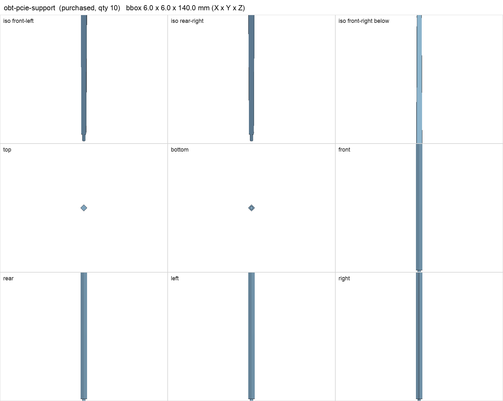
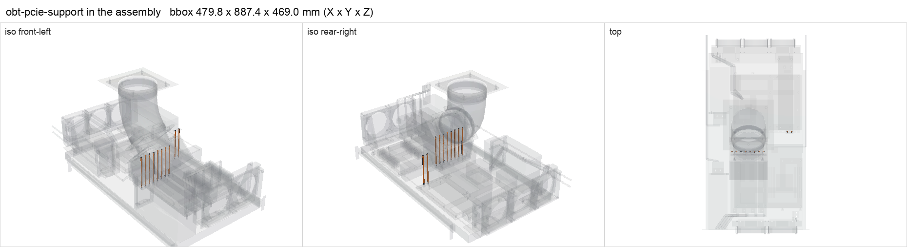

# Open Benchtable PCI-E support rod with nut

<!-- Generated by make check from part.toml. Edit part.toml, not this file. -->

| | |
| --- | --- |
| ID | `obt-pcie-support` |
| Category | purchased |
| Role | GPU bracket posts (two per card) |
| Status | selected |
| Quantity | 10 |
| Systems | berserk, kenshin |

## Model

- [obt-pcie-support.step](obt-pcie-support.step)
- Source: constructed
- Assembly: 20 instances in the assembly

## Datasheets

- None recorded. Open Benchtable publishes no drawing; the stud length is an owner measurement.

## Dimensions

| Key | Value | Evidence | Source / note |
| --- | --- | --- | --- |
| stud_length | 9 mm | measured | owner report 2026-10-23 |
| rod_length | 131 mm | allowance |  |
| mass | 0.03 kg | assumed |  |

## Interfaces

- requires `post-base-thread` value M3 female count 1 (measured)

## Compatibility checks

| Status | Rule | Interface | Detail |
| --- | --- | --- | --- |
| BLOCKED | budget | `shelf-load` | load 23.1 kg of 39.0 kg x derate 1.0 = 39.0 kg (59% of rating); unknown load for ['fan-controller'] |
| pass | value | `post-base-thread` | obt-pcie-support needs M3 female; provided by wurth-970140324 |
| pass | count | `post-base-thread` | need 10 x post-base-thread=m3 female, have 10 |

