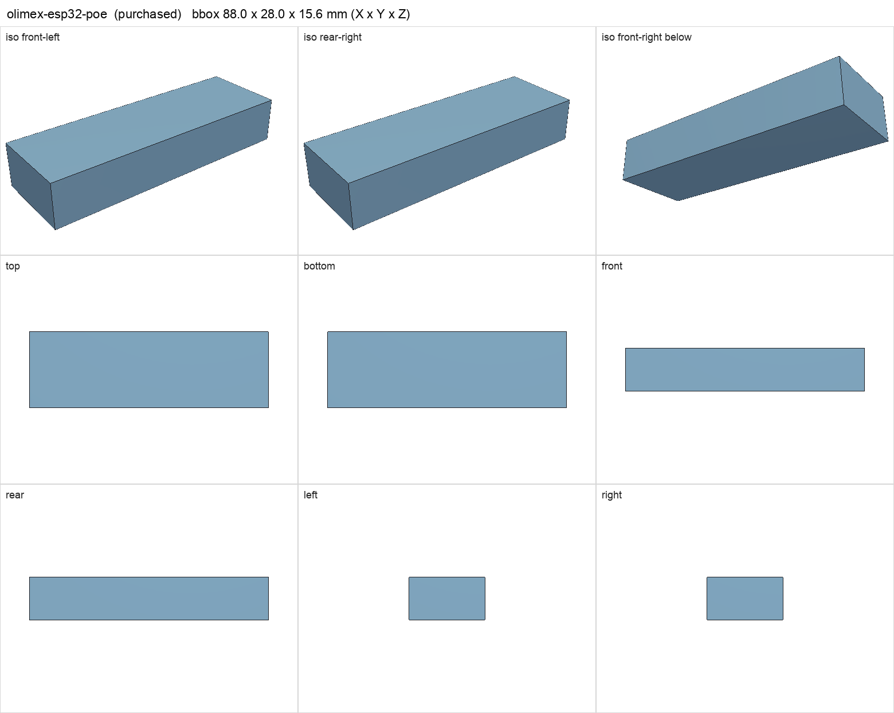

# Olimex ESP32-POE (ESP32-WROOM-32E-N4, 100 Mb Ethernet, hardware revision M2)

<!-- Generated by make check from part.toml. Edit part.toml, not this file. -->

| | |
| --- | --- |
| ID | `olimex-esp32-poe` |
| Category | purchased |
| Product | <https://www.olimex.com/Products/IoT/ESP32/ESP32-POE/open-source-hardware> |

Classic ESP32 (eight hardware pulse counters, one per fan tach) with a LAN8710A
100BASE-TX PHY and RJ45. Order the plain ESP32-POE (WROOM-32E-N4): the -WROVER
variants use GPIO16/17 for PSRAM, move the Ethernet clock to GPIO0 and tie GPIO33
into the clock buffer, which breaks the rack pin map.

Ethernet takes GPIO17 (clock out), 12 (PHY power), 18 (MDIO), 23 (MDC), 19, 21, 22,
25, 26 and 27 (RMII). Free on the two 10-pin extension headers (EXT1, EXT2, rows
25.4 mm apart, 2.54 mm pitch), from the rev M2 schematic and PCB nets:
  no board pull-up: GPIO4, 14, 32, 33, GPI35 (BAT_SENS_E1 jumper open by default)
  10 kOhm to 3.3 V: GPIO5 (R36), GPIO15 (R39), GPI36 (R37), GPI34 (R48 + user button)
  2.2 kOhm to 3.3 V: GPIO2 (RM3, also SD and auto-program diode), GPIO13 (R35), GPIO16 (R31)
  not usable: GPI39 (external-power divider R4/R9 from +5 V), GPIO0/1/3 (boot, UART).
GPIO2, 14 and 15 also go to the microSD socket; leave it empty.

Not galvanically isolated: never connect it to a PoE port while it is powered from
another supply, and never connect USB while EXT1 pin 1 (+5V) is fed (EXT1 +5V is the
USB 5 V net). Plug it only into a non-PoE switch port.

## Used in

| Build | Qty | Status | Role |
| --- | ---: | --- | --- |
| [rack](../../../rack/parts/olimex-esp32-poe.md) | 1 | selected | fan controller: reads both probes and all eight tachs, drives the two PWM channels, runs ESPHome on wired Ethernet |

## Model

- [olimex-esp32-poe.step](olimex-esp32-poe.step)
- Source: constructed. Board envelope plus the RJ45 overhang and component height; headers and module not modeled.
- Vendor CAD: KiCad PCB with 3D models: https://github.com/OLIMEX/ESP32-POE/tree/master/HARDWARE/ESP32-PoE-hardware-revision-M2
- Written by the `rack` build's generator

## Datasheets

- [ESP32-POE / ESP32-POE-ISO user manual rev 2.2 (June 2024)](https://www.electrokit.com/upload/quick/bc/c8/1fc3_ESP32-POE-user-manual.pdf)
- [ESP32-POE schematic, hardware revision M2](https://raw.githubusercontent.com/OLIMEX/ESP32-POE/master/HARDWARE/ESP32-PoE-hardware-revision-M2/ESP32-PoE_Rev_M2.pdf)
- [ESP32-POE dimension drawing, revision J and newer](https://raw.githubusercontent.com/OLIMEX/ESP32-POE/master/HARDWARE/Dimensions/Revision%20J%20and%20newer/esp32-poe-dimensions.png)
- Local copies: `datasheets/` after `make datasheets` (not committed)

## Dimensions

| Key | Value | Evidence | Source / note |
| --- | --- | --- | --- |
| board_length | 80 mm | datasheet | user manual 1.1: PCB 80 x 28 mm; dimension drawing |
| board_width | 28 mm | datasheet | user manual 1.1: PCB 80 x 28 mm; dimension drawing |
| header_row_spacing | 25.4 mm | datasheet | user manual 1.1: two extension connectors 0.1 in step spaced at 1 in; rev M2 PCB EXT1/EXT2 at x 91.44 / 116.84 |
| header_pitch | 2.54 mm | datasheet | user manual 1.1: 0.1 in step |
| header_pins | 10 None | datasheet | rev M2 schematic: EXT1 and EXT2 are HN1x10 |
| mounting_hole | 2.2 mm | datasheet | rev M2 PCB: MH1-MH3 NPTH 2.2 mm |
| rj45_overhang | 8 mm | allowance | scaled from the dimension drawing outline; measure the board |
| component_height | 14 mm | allowance | RJ45 jack above the PCB; not stated by Olimex |
| supply_current_5v | 0.2 A | datasheet | user manual 2.5: standard consumption 50 to 200 mA |
| mass | 0.02 kg | assumed |  |

## Interfaces

- requires `olimex-ext-socket` value 2 x 10, 2.54 mm, rows 25.4 mm apart count 1 (datasheet)
- requires `dc-5v` load 1 W (datasheet) — 200 mA at 5 V into EXT1 pin 1 (+5V), the manual's upper consumption figure
- requires `ethernet-1gbe-rj45` count 1 (datasheet) — 100BASE-TX, auto-negotiates on a 10/100/1000 port; must not be a PoE port (board not isolated)

