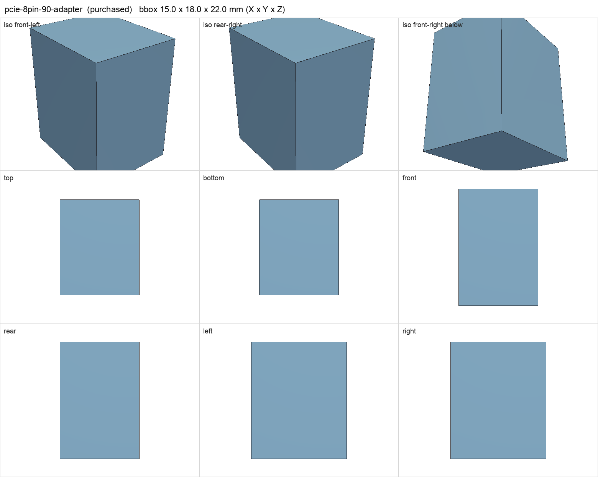

# 90 degree PCIe 8-pin power adapter (low profile)

<!-- Generated by make check from part.toml. Edit part.toml, not this file. -->

| | |
| --- | --- |
| ID | `pcie-8pin-90-adapter` |
| Category | purchased |

Turns a PCIe 8-pin plug through 90 degrees at the card socket so the cable
leaves low and clear of whatever sits in front of the card. Choose a product
whose exit direction matches the card's socket orientation and whose rating
covers the card's 8-pin load. It passes the PSU's 8-pin through, so it
declares no interfaces of its own: the card's pcie-8pin need is counted once.

## Used in

| Build | Qty | Status | Role |
| --- | ---: | --- | --- |
| [aipc](../../../aipc/parts/pcie-8pin-90-adapter.md) | 8 | candidate | keeps the MI50 power plugs low and clear of the front radiator |

## Model

- [pcie-8pin-90-adapter.step](pcie-8pin-90-adapter.step)
- Source: constructed. 15 x 18 x 22 mm plug target per adapter.
- Written by the `aipc` build's generator

## Datasheets

- None recorded. No product chosen yet; the 18 mm projection is a design target, not a product dimension.

## Dimensions

| Key | Value | Evidence | Source / note |
| --- | --- | --- | --- |
| projection | 18 mm | allowance |  |
| mass | 0.015 kg | assumed |  |

