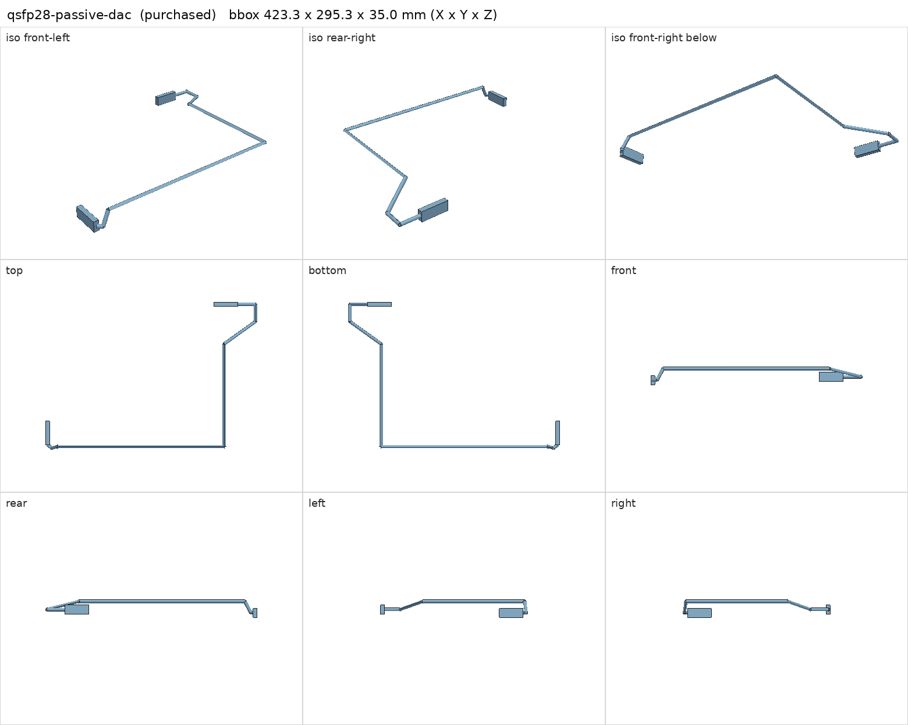

# QSFP28 passive copper direct-attach cable, 1 m (not chosen)

<!-- Generated by make check from part.toml. Edit part.toml, not this file. -->

| | |
| --- | --- |
| ID | `qsfp28-passive-dac` |
| Category | purchased |

Direct Berserk-Kenshin link between the two ConnectX-4 Lx cards, no switch.
The 1 m length comes from the AIPC cable route (models/fit-report.json,
network section) plus both plugs and slack; check it again once the plugs
and route are measured. Confirm the chosen cable is on NVIDIA's ConnectX-4 Lx
firmware compatibility list and links at 50GbE.

## Used in

| Build | Qty | Status | Role |
| --- | ---: | --- | --- |
| [aipc](../../../aipc/parts/qsfp28-passive-dac.md) | 1 | candidate | Direct Berserk-Kenshin 50GbE link between the two ConnectX-4 Lx cards |

## Model

- [qsfp28-passive-dac.step](qsfp28-passive-dac.step)
- Source: constructed. Plug envelopes and a route polyline in the AIPC assembly.
- Written by the `aipc` build's generator

## Datasheets

- None recorded. No cable chosen yet. The plug and cable dimensions are generic QSFP28 allowances; replace them with the chosen cable's drawing (for example an NVIDIA MCP1600 100GbE passive DAC, which the ConnectX-4 Lx runs at 50GbE).

## Dimensions

| Key | Value | Evidence | Source / note |
| --- | --- | --- | --- |
| length | 1000 mm | allowance | from the AIPC route; not a chosen product |
| plug_width | 18.35 mm | assumed | nominal QSFP plug body width; not checked against SFF-8661 |
| plug_height | 8.5 mm | assumed | nominal QSFP plug body height; not checked against SFF-8661 |
| plug_length_outside | 48 mm | allowance | plug body and pull tab past the card bracket, before the cable bends |
| cable_od | 6.5 mm | allowance |  |
| bend_radius | 35 mm | allowance |  |
| mass | 0.1 kg | assumed |  |

## Interfaces

- provides `qsfp28-dac` value QSFP28 passive DAC, 50GbE count 2 (allowance) — one cable serves both cards
- requires `qsfp28-port` value QSFP28 50GbE count 2 (allowance) — one plug in each ConnectX-4 Lx cage

