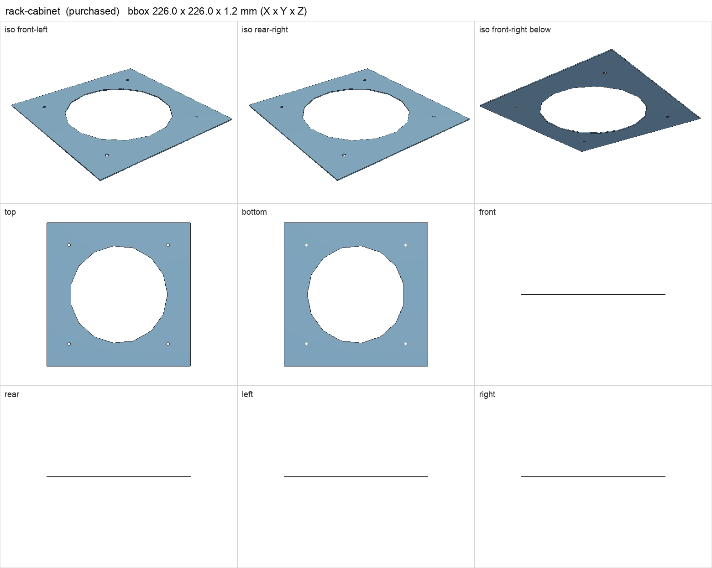

# SysRacks SP 12.900 12U soundproof cabinet (600 x 900)

<!-- Generated by make check from part.toml. Edit part.toml, not this file. -->

| | |
| --- | --- |
| ID | `rack-cabinet` |
| Category | purchased |

Free-standing acoustic cabinet on casters. Steel carcass lined inside with egg-crate
foam on the sides, inner top, floor and both doors; glass front door; removable outer
side panels; separate outer top lid. Two stock fans sit in the inner top under the
lid and exhaust through the gap around the lid edge; fresh air enters at the sides and
bottom (washable filter, foam cable entry in the floor). The stock air-control panel
switches the fans on above a set temperature (10-50 C, one wired probe) and off below
it. SysRacks claims "up to 36% noise reduction" (the catalog also says 36 dB(A)).

Sources disagree: the drawing is titled 600*900 and shows 488.95 mm of rail height
(11U), while the product page lists 12U, 26 in (66 cm) width, 35 in (88.9 cm) depth
and a "height" of 21 in (53.4 cm), which is exactly 12U of rail, not the outside height.
The drawing is low resolution. Everything inside (clear depth between the door
foams, clear height, clear width, stock fan size) is unmeasured: measure before
fitting a shelf or cutting a panel. The front and rear door clearances, the height
above the shelf and the post depth stay unknown until then.

## Used in

| Build | Qty | Status | Role |
| --- | ---: | --- | --- |
| [aipc](../../../aipc/parts/rack-cabinet.md) | 1 | selected | cabinet that receives the shelf and the roof exhaust |
| [gpulab](../../../gpulab/parts/rack-cabinet.md) | 1 | selected | cabinet that receives the GPU lab shelf |
| [rack](../../../rack/parts/rack-cabinet.md) | 1 | selected | acoustic cabinet: exhaust fans replace the stock roof fans, intake fans under the floor, controller and supply under the lid |

## Model

- [rack-cabinet.step](rack-cabinet.step)
- Source: constructed. AIPC models only a provisional inner-ceiling patch at Z400; the rack build models the outer shell from the drawing.
- Written by the `aipc` build's generator

## Datasheets

- [SysRacks SP 12.900 product page](https://sysracks.com/product/12u-35-depth-foor-standing-sound-proof-server-cabinet-sp-12-900/)
- [SysRacks soundproof server cabinet manual](https://office.sysracks.com/storage/files/files/2234/sysracks-soundproof-servrer-cabinet-manual.pdf)
- [SysRacks 12U 600x900 soundproof cabinet drawing](https://office.sysracks.com/storage/files/files/2918/12u600x900-soundproof-1-1024x726.png)
- Local copies: `datasheets/` after `make datasheets` (not committed)

## Dimensions

| Key | Value | Evidence | Source / note |
| --- | --- | --- | --- |
| outer_width | 600 mm | datasheet | SysRacks drawing title 600*900; product page says 26 in (660 mm); measure |
| outer_depth | 900 mm | datasheet | SysRacks drawing (900), product page 35 in (889 mm) |
| body_height | 692 mm | datasheet | SysRacks drawing: 692 floor to top of lid |
| height_on_casters | 771.5 mm | datasheet | SysRacks drawing: 771.5 overall |
| floor_clearance | 79.5 mm | datasheet | SysRacks drawing: 771.5 - 692, floor underside above the ground |
| rail_height | 488.95 mm | datasheet | SysRacks drawing: 488.95 = 11U of rail |
| rail_hole_spacing | 465 mm | datasheet | SysRacks drawing: 465 (EIA-310 19 in) |
| rail_opening | 450 mm | datasheet | SysRacks drawing: 450 between rails |
| rail_depth_max | 787.4 mm | listing | SysRacks product page: rail-to-rail max 31 in; the feature list says 33 in; minimum not stated |
| lid_thickness | 50 mm | photo-estimate | SysRacks drawing proportions; measure |
| wall_thickness | 30 mm | assumed | steel plus foam; measure each side, the doors and the floor |
| panel_sheet_thickness | **unknown**  | unknown | bare steel of the inner top and the floor, where the fans mount; sets the nibbler, the edge trim and the screw length |
| interior_depth | **unknown**  | unknown | clear depth between the front and rear door foams |
| interior_height_above_shelf | **unknown**  | unknown |  |
| post_depth | **unknown**  | unknown | rails adjustable up to 31 in (or 33 in) |
| stock_fan_count | 2 None | datasheet | SysRacks manual step 1 and product page |
| stock_fan_size | **unknown**  | unknown | photo suggests about 120 mm; measure |
| thermostat_range_max | 50 C | datasheet | SysRacks manual p.10: limit 10-50 C |
| load_rating | 199.6 kg | listing | Newegg and SysRacks listings: 440 lb |
| mass | 63 kg | listing | SysRacks product page: 138.9 lb |

## Interfaces

- provides `rack-standard` value EIA-310 19 in (datasheet) — 465 mm hole spacing on the SysRacks drawing
- provides `rack-post-depth` (datasheet) — adjustable up to 31 in (787.4 mm); set it and measure once the cabinet is assembled
- provides `rack-units` count 11 (datasheet) — 488.95 mm of rail on the drawing; listed as 12U
- provides `cabinet-front-clearance` (datasheet) — glass front door with a foam-lined frame; measure from the front rail plane to the door
- provides `cabinet-rear-clearance` (datasheet) — foam-lined rear door; measure from the rear rail plane to the door foam
- provides `cabinet-height-above-shelf` (datasheet) — inner top carries the two stock fans; measure once the shelf height is set
- provides `panel-sheet-edge` (unknown) — cut edge of the fan openings in the inner top and floor steel; thickness not measured

