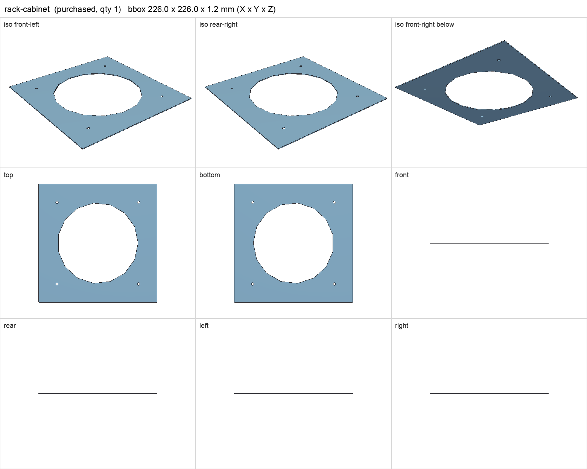
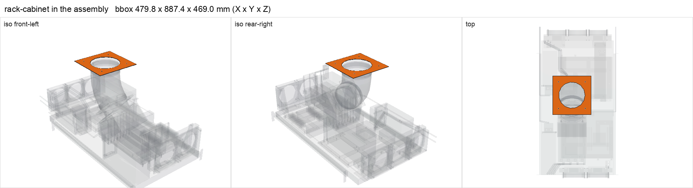

# Rack cabinet (not yet specified)

<!-- Generated by make check from part.toml. Edit part.toml, not this file. -->

| | |
| --- | --- |
| ID | `rack-cabinet` |
| Category | purchased |
| Role | cabinet that receives the shelf and the roof exhaust |
| Status | unspecified |
| Quantity | 1 |
| Systems | rack |

The cabinet has never been identified, so the shelf, slides, rear radiator
projection and roof duct cannot be checked against it. Record make/model,
post spacing, usable depth, door clearance and interior height here before
buying the shelf or drilling anything.

## Model

- [rack-cabinet.step](rack-cabinet.step)
- Source: constructed. Only the provisional inner-ceiling patch at Z400 is modeled.
- Assembly: 1 instances in the assembly

## Datasheets

- None recorded. 

## Dimensions

| Key | Value | Evidence | Source / note |
| --- | --- | --- | --- |
| post_depth | **unknown**  | unknown |  |
| interior_depth | **unknown**  | unknown |  |
| interior_height_above_shelf | **unknown**  | unknown |  |

## Interfaces

- provides `rack-standard` (unknown) — unknown until the cabinet is identified
- provides `rack-post-depth` (unknown)
- provides `rack-units` count **unknown** (unknown)
- provides `cabinet-front-clearance` (unknown)
- provides `cabinet-rear-clearance` (unknown)
- provides `cabinet-height-above-shelf` (unknown)

## Compatibility checks

| Status | Rule | Interface | Detail |
| --- | --- | --- | --- |
| BLOCKED | value | `cabinet-front-clearance` | system needs 20.0; provider value unknown |
| BLOCKED | value | `cabinet-height-above-shelf` | system needs 400.0; provider value unknown |
| BLOCKED | value | `cabinet-rear-clearance` | system needs 176.3; provider value unknown |
| BLOCKED | value | `rack-post-depth` | hammond-rsus1931bk1 needs 457.2..711.2; provider value unknown |
| BLOCKED | value | `rack-standard` | hammond-rsus1931bk1 needs EIA-310 19 in; provider value unknown |
| BLOCKED | count | `rack-units` | need 11 x rack-units, have None |

