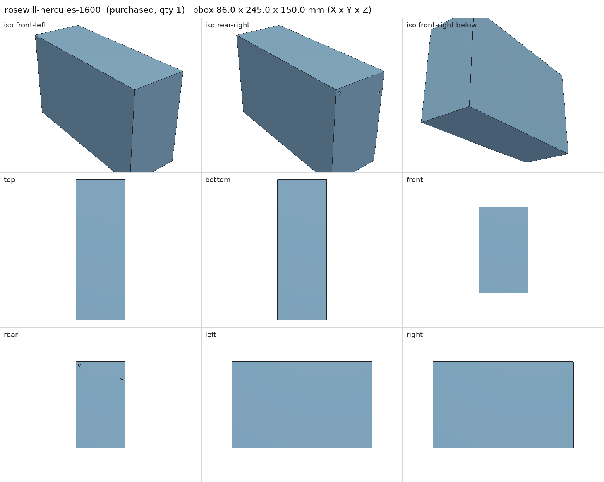
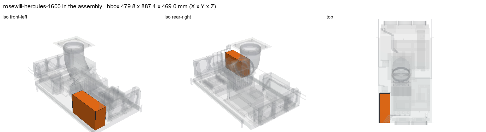

# Rosewill Hercules 1600 W PSU (reused)

<!-- Generated by make check from part.toml. Edit part.toml, not this file. -->

| | |
| --- | --- |
| ID | `rosewill-hercules-1600` |
| Category | purchased |
| Role | Berserk PSU |
| Status | owned |
| Quantity | 1 |
| Systems | berserk |

## Model

- [rosewill-hercules-1600.step](rosewill-hercules-1600.step)
- Source: constructed
- Assembly: 1 instances in the assembly

## Datasheets

- None recorded. Owned unit; record its model number and add Rosewill's spec sheet. Connector counts below are assumptions.

## Dimensions

| Key | Value | Evidence | Source / note |
| --- | --- | --- | --- |
| width | 150 mm | standard | ATX PSU face 150 x 86 |
| height | 86 mm | standard | ATX PSU face 150 x 86 |
| depth | 245 mm | allowance | about 241 mm nominal plus margin |
| mass | 3.5 kg | assumed |  |

## Interfaces

- provides `dc-power` capacity 1600 W (listing)
- provides `atx-24pin` count 1 (assumed)
- provides `eps-8pin-cpu` count 2 (assumed)
- provides `pcie-8pin` count 8 (assumed)
- provides `peripheral-12v` count 2 (assumed) — 4-pin peripheral (Molex) leads; count assumed
- provides `sata-power` count **unknown** (unknown) — SATA power leads in the modular cable set; number not yet counted
- requires `psu-restraint` value ATX 150 x 86 face count 1 (assumed)
- requires `ac-power` load 1522 W (allowance) — Berserk DC peak 1370 W / ~0.9 efficiency

## Compatibility checks

| Status | Rule | Interface | Detail |
| --- | --- | --- | --- |
| BLOCKED | budget | `ac-power` | load 2531.0 W; capacity unknown |
| BLOCKED | count | `sata-power` | need 1 x sata-power, have None |
| provisional | count | `atx-24pin` | need 1 x atx-24pin, have 1 |
| provisional | budget | `dc-power` | load 1096.0 W of 1600.0 W x derate 0.8 = 1280.0 W (68% of rating); relies on configured limits of ['nvidia-v100-pcie-16gb']; unlimited peak 1376.0 W |
| provisional | budget | `dc-power` | load 23.2 W of 2800.0 W x derate 0.8 = 2240.0 W (1% of rating) |
| provisional | count | `eps-8pin-cpu` | need 2 x eps-8pin-cpu, have 2 |
| provisional | count | `pcie-8pin` | need 8 x pcie-8pin, have 8 |
| provisional | count | `peripheral-12v` | need 1 x peripheral-12v, have 2 |
| provisional | value | `psu-restraint` | rosewill-hercules-1600 needs ATX 150 x 86 face; provided by psu_bracket |
| provisional | count | `psu-restraint` | need 2 x psu-restraint=atx 150 x 86 face, have 2 |
| provisional | budget | `shelf-load` | load 23.7 kg of 39.0 kg x derate 1.0 = 39.0 kg (61% of rating) |

