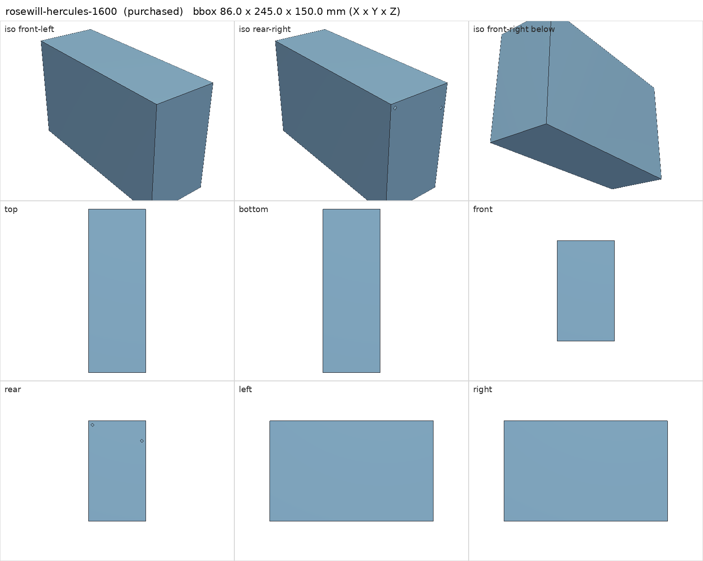

# Rosewill Hercules 1600 W PSU (reused)

<!-- Generated by make check from part.toml. Edit part.toml, not this file. -->

| | |
| --- | --- |
| ID | `rosewill-hercules-1600` |
| Category | purchased |
| Review | <https://www.techpowerup.com/review/rosewill-hercules-1600/> |

OEM High Power (twin of the RockSolid Pro 1600 W). Native (fixed) AWG16 cables:
20+4 pin ATX (600 mm), one 4+4 pin EPS and one 8 pin EPS (700 mm), both EPS on
12V2 (50 A). Eight modular AWG18 PCIe cables, each with two 6+2 pin plugs
(660 mm + 150 mm), on 12V1 (110 A). There are no modular EPS sockets, and the
PSU-side modular pinout is unpublished: measure it before using any cable that
did not ship with the unit.

## Used in

| Build | Qty | Status | Role |
| --- | ---: | --- | --- |
| [aipc](../../../aipc/parts/rosewill-hercules-1600.md) | 1 | owned | Berserk PSU |

## Model

- [rosewill-hercules-1600.step](rosewill-hercules-1600.step)
- Source: constructed
- Written by the `aipc` build's generator

## Datasheets

- [TechPowerUp review (no manufacturer spec sheet found)](https://www.techpowerup.com/review/rosewill-hercules-1600/)
- Local copies: `datasheets/` after `make datasheets` (not committed)

## Dimensions

| Key | Value | Evidence | Source / note |
| --- | --- | --- | --- |
| width | 150 mm | review | TechPowerUp: 150 x 86 x 243 mm |
| height | 86 mm | review | TechPowerUp: 150 x 86 x 243 mm |
| depth | 245 mm | allowance | 243 mm (TechPowerUp) plus margin |
| mass | 3.5 kg | review | TechPowerUp |

## Interfaces

- provides `dc-power` capacity 1600 W (review) — 12V1 110 A (PCIe, peripheral, SATA, ATX); 12V2 50 A (EPS1, EPS2); 1560 W combined +12 V
- provides `atx-24pin` count 1 (review) — 20+4 pin, native
- provides `eps-8pin-cpu` count 2 (review) — Native AWG16 cables: one 4+4 pin, one 8 pin
- provides `pcie-8pin` count 16 (review) — 6+2 pin, two per modular AWG18 cable on eight modular sockets
- provides `peripheral-12v` count 6 (review) — 4-pin Molex on modular cables (review lists 6 / 2)
- provides `sata-power` count 16 (review)
- requires `psu-restraint` value ATX 150 x 86 face count 1 (review)
- requires `ac-power` load 1522 W (allowance) — Berserk DC peak 1370 W / ~0.9 efficiency

