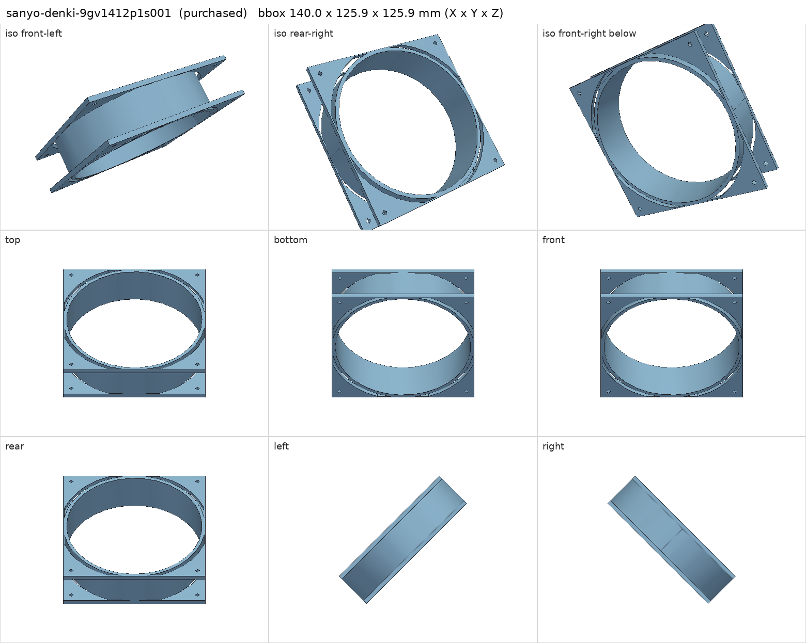

# Sanyo Denki San Ace 9GV1412P1S001 140 x 38 mm fan

<!-- Generated by make check from part.toml. Edit part.toml, not this file. -->

| | |
| --- | --- |
| ID | `sanyo-denki-9gv1412p1s001` |
| Category | purchased |

12 V, 3.1 A, 37.2 W at 100% PWM; 272 CFM, 480 Pa (catalog p.185). Motor fed from the PSU by fan-power-harness; PWM from the QUADRO. An open PWM line runs it at 100%.

## Used in

| Build | Qty | Status | Role |
| --- | ---: | --- | --- |
| [aipc](../../../aipc/parts/sanyo-denki-9gv1412p1s001.md) | 1 | selected | pressure fan pulling air through the four V100s |

## Model

- [sanyo-denki-9gv1412p1s001.step](sanyo-denki-9gv1412p1s001.step)
- Source: constructed. Body envelope tilted 45 degrees on the hood panel.
- Vendor CAD: https://products.sanyodenki.com/en/sanace/dc/ (CAD after registration)
- Written by the `aipc` build's generator

## Datasheets

- [San Ace catalog, pp. 185-188](https://publish.sanyodenki.com/San_Ace_E/book/data/San_Ace_E.pdf)
- Local copies: `datasheets/` after `make datasheets` (not committed)

## Dimensions

| Key | Value | Evidence | Source / note |
| --- | --- | --- | --- |
| size | 140 mm | datasheet | San Ace catalog |
| depth | 38 mm | datasheet | San Ace catalog |
| hole_pitch | 124.5 mm | datasheet | San Ace catalog |
| current | 3.1 A | datasheet | San Ace catalog |
| mass | 0.63 kg | datasheet | San Ace catalog p.185, 630 g |

## Interfaces

- provides `gpu-forced-airflow` count 4 (allowance) — free-air rating; loaded airflow through the hood unqualified
- requires `fan-mount` value 140 mm, 124.5 mm pitch count 2 (datasheet) — inlet on the hood panel, outlet on the exhaust flange
- requires `fan-power` value 12 V PWM 4-wire, 3.1 A count 1 (datasheet)
- requires `dc-power` load 37.2 (datasheet)

