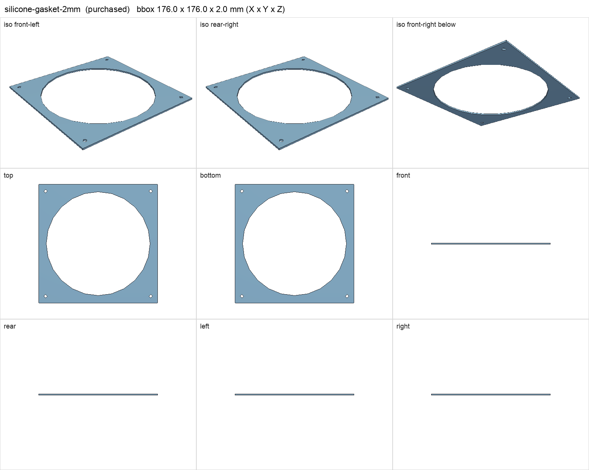

# 2 mm silicone foam gasket sheet, 200 x 200 mm

<!-- Generated by make check from part.toml. Edit part.toml, not this file. -->

| | |
| --- | --- |
| ID | `silicone-gasket-2mm` |
| Category | purchased |

## Used in

| Build | Qty | Status | Role |
| --- | ---: | --- | --- |
| [aipc](../../../aipc/parts/silicone-gasket-2mm.md) | 1 | candidate | roof flange seal |

## Model

- [silicone-gasket-2mm.step](silicone-gasket-2mm.step)
- Source: constructed
- Written by the `aipc` build's generator

## Datasheets

- None recorded. Generic sheet.

