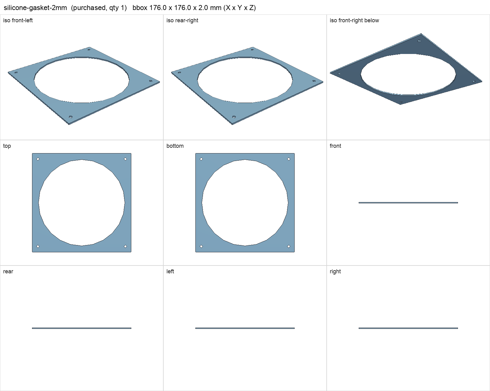
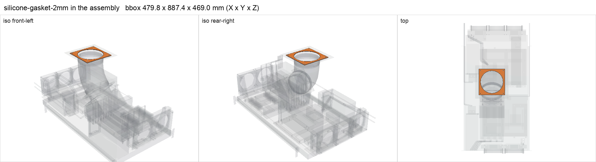

# 2 mm silicone foam gasket sheet, 200 x 200 mm

<!-- Generated by make check from part.toml. Edit part.toml, not this file. -->

| | |
| --- | --- |
| ID | `silicone-gasket-2mm` |
| Category | purchased |
| Role | roof flange seal |
| Status | candidate |
| Quantity | 1 |
| Systems | berserk |

## Model

- [silicone-gasket-2mm.step](silicone-gasket-2mm.step)
- Source: constructed
- Assembly: 1 instances in the assembly

## Datasheets

- None recorded. Generic sheet.

