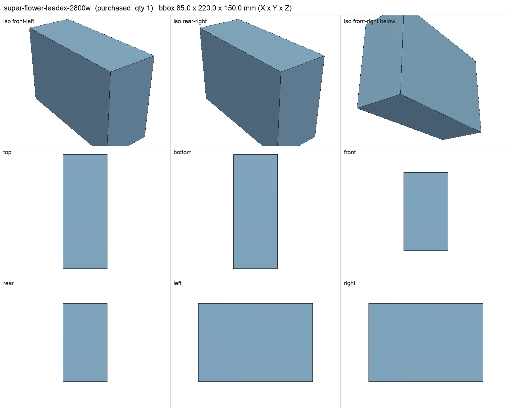

# Super Flower Leadex 2800W ATX 3.1 (SF-2800F14HP)

<!-- Generated by make check from part.toml. Edit part.toml, not this file. -->

| | |
| --- | --- |
| ID | `super-flower-leadex-2800w` |
| Category | purchased |
| Product | <https://www.super-flower.com.tw/> |
| Review | <https://hwbusters.com/psus/super-flower-leadex-2800w-atx-v3-1-psu-review/> |

200-240 V input only; no 115 V rating is published. Super Flower's own spec
page was not reachable, so the values come from the HWBusters review; sources
disagree on depth (200 mm review and PCPartPicker, 220 mm Puget): the model uses
220 mm. Lies on its side beside the board, fan facing the deck centre.

## Used in

- No build references this part.

## Model

- [super-flower-leadex-2800w.step](super-flower-leadex-2800w.step)
- Source: constructed

## Datasheets

- [HWBusters review (no manufacturer spec sheet found)](https://hwbusters.com/psus/super-flower-leadex-2800w-atx-v3-1-psu-review/)
- Local copies: `datasheets/` after `make datasheets` (not committed)

## Dimensions

| Key | Value | Evidence | Source / note |
| --- | --- | --- | --- |
| width | 150 mm | review | HWBusters |
| height | 85 mm | review | HWBusters; Puget lists 86 |
| depth | 220 mm | listing | Puget 220 mm; HWBusters and PCPartPicker 200 mm; larger value used |
| mass | 2.99 kg | review | HWBusters |

## Interfaces

- provides `dc-power` capacity 2800 W (review) — +12 V 233.3 A
- provides `atx-24pin` count 1 (review)
- provides `eps-8pin-cpu` count 2 (review)
- provides `12v-2x6` count 4 (review)
- provides `pcie-8pin` count 6 (review) — 6+2 pin connectors
- provides `sata-power` count 16 (review)
- provides `peripheral-12v` count 4 (review)
- requires `ac-power` load 3060 W (allowance) — 2.8 kW output / ~0.915 efficiency at full load

