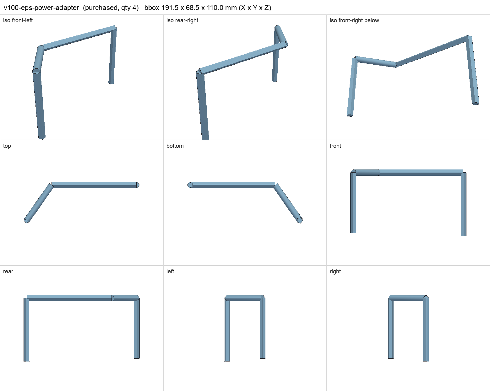
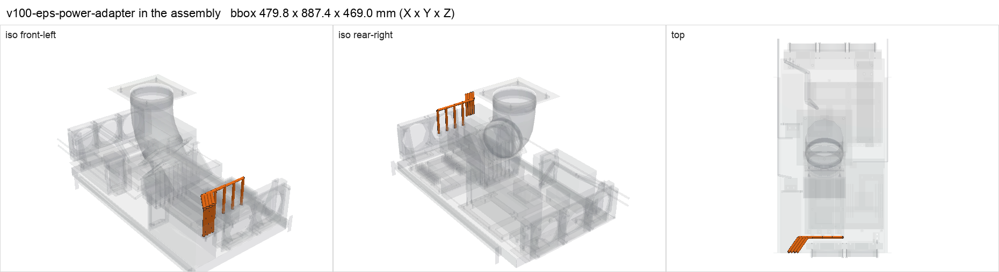

# Dual PCIe 8-pin to CPU/EPS 8-pin GPU adapter (030-0571-000 compatible)

<!-- Generated by make check from part.toml. Edit part.toml, not this file. -->

| | |
| --- | --- |
| ID | `v100-eps-power-adapter` |
| Category | purchased |
| Role | V100 auxiliary power adapter |
| Status | selected |
| Quantity | 4 |
| Systems | berserk |

## Model

- [v100-eps-power-adapter.step](v100-eps-power-adapter.step)
- Source: constructed. Cable route survey segments only.
- Assembly: 16 instances in the assembly

## Datasheets

- None recorded. Generic marketplace adapter; check its pinout against the NVIDIA brief before use.

## Dimensions

| Key | Value | Evidence | Source / note |
| --- | --- | --- | --- |
| mass | 0.05 kg | assumed |  |

## Interfaces

- provides `v100-aux-power` value CPU/EPS 8-pin count 1 (listing)
- requires `pcie-8pin` count 2 (listing)

## Compatibility checks

| Status | Rule | Interface | Detail |
| --- | --- | --- | --- |
| BLOCKED | budget | `shelf-load` | load 23.1 kg of 39.0 kg x derate 1.0 = 39.0 kg (59% of rating); unknown load for ['fan-controller'] |
| provisional | count | `pcie-8pin` | need 8 x pcie-8pin, have 8 |
| provisional | value | `v100-aux-power` | nvidia-v100-pcie-16gb needs CPU/EPS 8-pin; provided by v100-eps-power-adapter |
| provisional | count | `v100-aux-power` | need 4 x v100-aux-power=cpu/eps 8-pin, have 4 |

