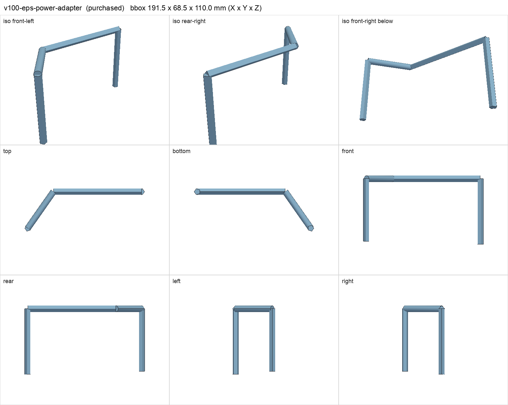

# Dual PCIe 8-pin to CPU/EPS 8-pin GPU adapter (030-0571-000 compatible)

<!-- Generated by make check from part.toml. Edit part.toml, not this file. -->

| | |
| --- | --- |
| ID | `v100-eps-power-adapter` |
| Category | purchased |

## Used in

| Build | Qty | Status | Role |
| --- | ---: | --- | --- |
| [aipc](../../../aipc/parts/v100-eps-power-adapter.md) | 4 | selected | V100 auxiliary power adapter |

## Model

- [v100-eps-power-adapter.step](v100-eps-power-adapter.step)
- Source: constructed. Cable route survey segments only.
- Written by the `aipc` build's generator

## Datasheets

- None recorded. Generic marketplace adapter; check its pinout against the NVIDIA brief before use.

## Dimensions

| Key | Value | Evidence | Source / note |
| --- | --- | --- | --- |
| mass | 0.05 kg | assumed |  |

## Interfaces

- provides `v100-aux-power` value CPU/EPS 8-pin count 1 (listing)
- requires `pcie-8pin` count 2 (listing)

