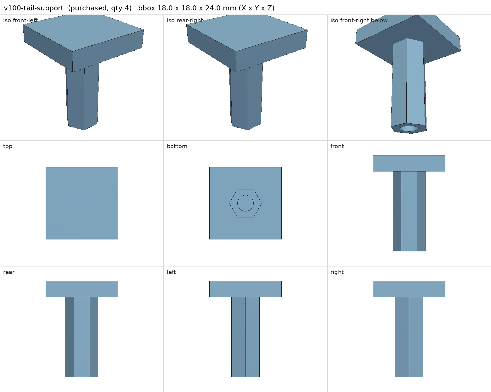
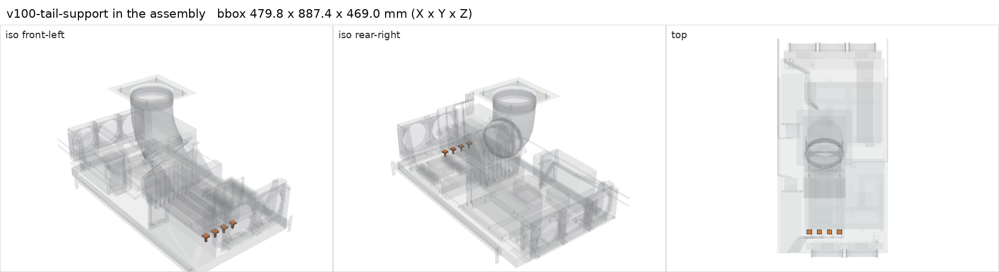

# M4 F/F 20 mm metal spacer with 4 mm silicone pad

<!-- Generated by make check from part.toml. Edit part.toml, not this file. -->

| | |
| --- | --- |
| ID | `v100-tail-support` |
| Category | purchased |
| Role | V100 tail support |
| Status | candidate |
| Quantity | 4 |
| Systems | berserk |

## Model

- [v100-tail-support.step](v100-tail-support.step)
- Source: constructed
- Assembly: 8 instances in the assembly

## Datasheets

- None recorded. Generic hardware; choose after measuring the card frame height.

## Dimensions

| Key | Value | Evidence | Source / note |
| --- | --- | --- | --- |
| spacer_length | 20 mm | allowance |  |
| pad_thickness | 4 mm | allowance |  |
| mass | 0.01 kg | assumed |  |

## Compatibility checks

| Status | Rule | Interface | Detail |
| --- | --- | --- | --- |
| BLOCKED | budget | `shelf-load` | load 23.2 kg of 39.0 kg x derate 1.0 = 39.0 kg (59% of rating); unknown load for ['fan-controller'] |

