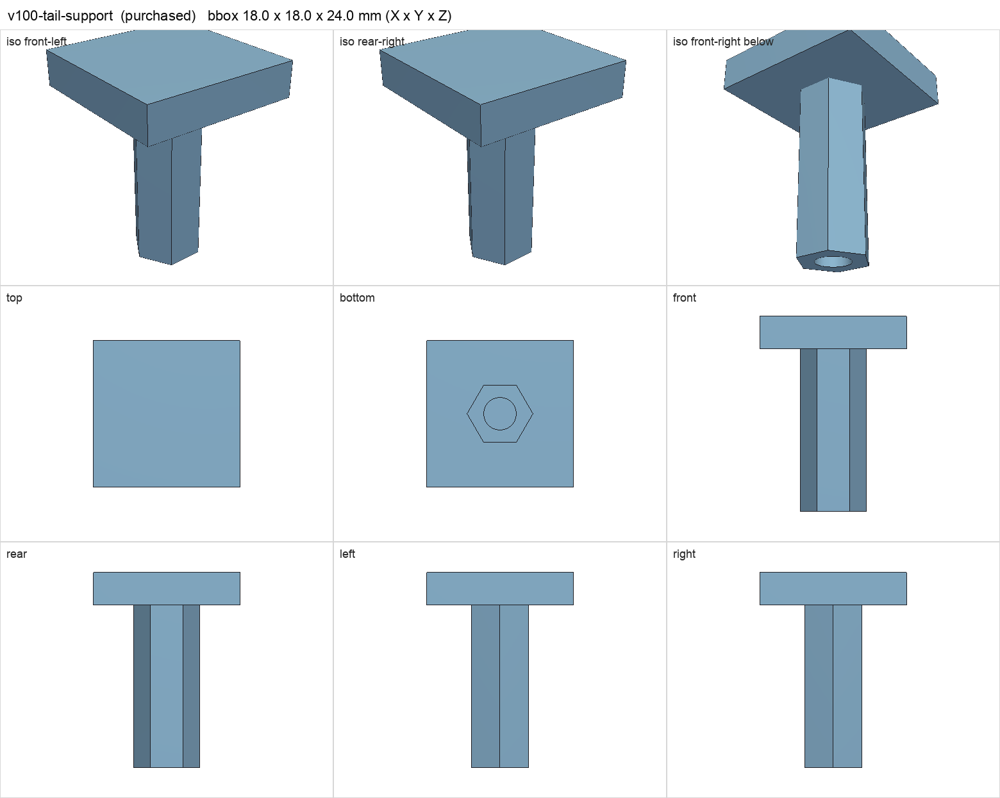

# M4 F/F 20 mm metal spacer with 4 mm silicone pad

<!-- Generated by make check from part.toml. Edit part.toml, not this file. -->

| | |
| --- | --- |
| ID | `v100-tail-support` |
| Category | purchased |

## Used in

| Build | Qty | Status | Role |
| --- | ---: | --- | --- |
| [aipc](../../../aipc/parts/v100-tail-support.md) | 4 | candidate | MI50 tail support |

## Model

- [v100-tail-support.step](v100-tail-support.step)
- Source: constructed
- Written by the `aipc` build's generator

## Datasheets

- None recorded. Generic hardware; choose after measuring the card frame height.

## Dimensions

| Key | Value | Evidence | Source / note |
| --- | --- | --- | --- |
| spacer_length | 20 mm | allowance |  |
| pad_thickness | 4 mm | allowance |  |
| mass | 0.01 kg | assumed |  |

