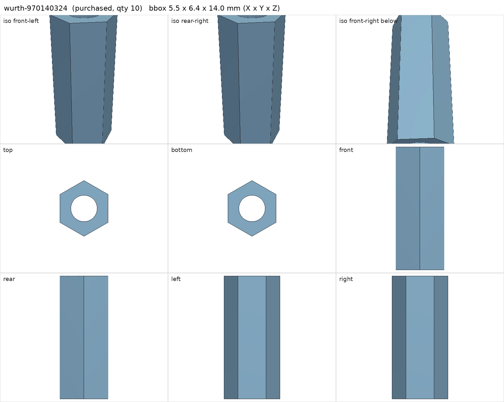
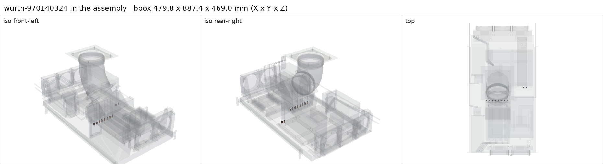

# Wurth 970140324 M3 F/F standoff, 14 mm, SW5.5

<!-- Generated by make check from part.toml. Edit part.toml, not this file. -->

| | |
| --- | --- |
| ID | `wurth-970140324` |
| Category | purchased |
| Role | GPU post bases, bearing directly on the steel shelf |
| Status | selected |
| Quantity | 10 |
| Systems | berserk, kenshin |
| Listing | <https://www.digikey.com/en/products/detail/w%C3%BCrth-elektronik/970140324/9488563> |

## Model

- [wurth-970140324.step](wurth-970140324.step)
- Source: constructed
- Vendor CAD: https://www.we-online.com/en/components/products/WA-SSTII (STEP per part number)
- Assembly: 10 instances in the assembly

## Datasheets

- [Wurth 970140324 drawing](https://www.we-online.com/components/products/datasheet/970140324.pdf)
- Local copies: `datasheets/` after `make datasheets` (not committed)

## Dimensions

| Key | Value | Evidence | Source / note |
| --- | --- | --- | --- |
| height | 14 mm | datasheet | Wurth drawing |
| across_flats | 5.5 mm | datasheet | Wurth drawing |
| thread_length | 14 mm | datasheet | Wurth drawing, through thread |
| mass | 0.003 kg | assumed |  |

## Interfaces

- provides `post-base-thread` value M3 female count 1 (datasheet)

## Compatibility checks

| Status | Rule | Interface | Detail |
| --- | --- | --- | --- |
| provisional | budget | `shelf-load` | load 23.7 kg of 39.0 kg x derate 1.0 = 39.0 kg (61% of rating) |
| pass | value | `post-base-thread` | obt-pcie-support needs M3 female; provided by wurth-970140324 |
| pass | count | `post-base-thread` | need 10 x post-base-thread=m3 female, have 10 |

