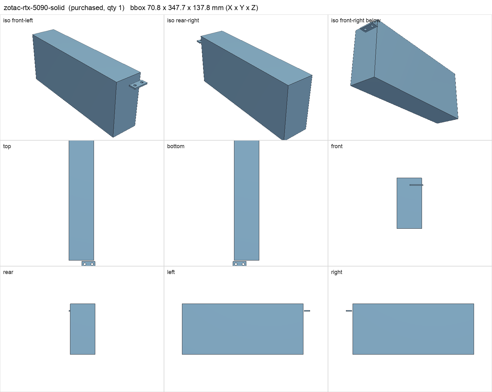
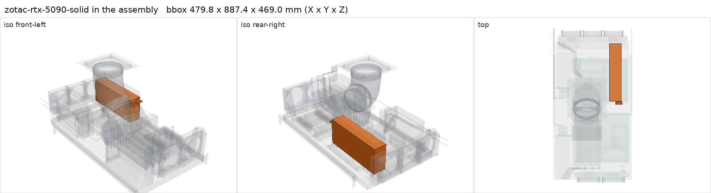

# Zotac Gaming GeForce RTX 5090 Solid 32 GB

<!-- Generated by make check from part.toml. Edit part.toml, not this file. -->

| | |
| --- | --- |
| ID | `zotac-rtx-5090-solid` |
| Category | purchased |
| Role | Kenshin GPU |
| Status | owned |
| Quantity | 1 |
| Systems | kenshin |

## Model

- [zotac-rtx-5090-solid.step](zotac-rtx-5090-solid.step)
- Source: constructed
- Assembly: 2 instances in the assembly

## Datasheets

- [Zotac RTX 5090 Solid specifications](https://www.zotac.com/us/product/graphics_card/zotac-gaming-geforce-rtx-5090-solid)
- Local copies: `datasheets/` after `make datasheets` (not committed)

## Dimensions

| Key | Value | Evidence | Source / note |
| --- | --- | --- | --- |
| length | 329.7 mm | datasheet | Zotac published dimensions |
| height | 137.8 mm | datasheet | Zotac published dimensions |
| thickness | 67.8 mm | datasheet | Zotac published dimensions |
| tgp | 575 W | datasheet | NVIDIA RTX 5090 total graphics power |
| mass | 2.2 kg | assumed |  |

## Interfaces

- requires `pcie-x16-slot` value PCIe x16 count 1 (datasheet)
- requires `gpu-power` value 12V-2x6 count 1 (datasheet)
- requires `dc-power` load 575 (datasheet)

## Compatibility checks

| Status | Rule | Interface | Detail |
| --- | --- | --- | --- |
| BLOCKED | count | `gpu-power` | need 1 x gpu-power=12v-2x6, have None |
| provisional | budget | `dc-power` | load 908.0 W of 1200.0 W x derate 0.8 = 960.0 W (76% of rating) |
| provisional | value | `gpu-power` | zotac-rtx-5090-solid needs 12V-2x6; provided by corsair-hx1200i |
| provisional | budget | `shelf-load` | load 23.7 kg of 39.0 kg x derate 1.0 = 39.0 kg (61% of rating) |
| pass | value | `pcie-x16-slot` | zotac-rtx-5090-solid needs PCIe x16; provided by gigabyte-x870e-aorus-pro |
| pass | count | `pcie-x16-slot` | need 1 x pcie-x16-slot=pcie x16, have 1 |

