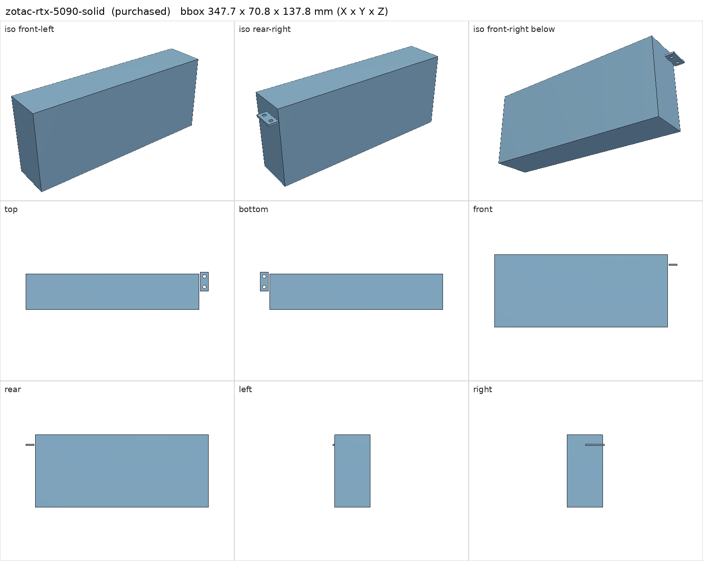

# Zotac Gaming GeForce RTX 5090 Solid 32 GB

<!-- Generated by make check from part.toml. Edit part.toml, not this file. -->

| | |
| --- | --- |
| ID | `zotac-rtx-5090-solid` |
| Category | purchased |
| Product | <https://www.zotac.com/us/product/graphics_card/zotac-gaming-geforce-rtx-5090-solid> |

Open-air, three axial fans: heat goes into the surrounding air. Reviews call it 3.5- or 4-slot; plan on 67.8 mm.

## Used in

| Build | Qty | Status | Role |
| --- | ---: | --- | --- |
| [aipc](../../../aipc/parts/zotac-rtx-5090-solid.md) | 1 | owned | Kenshin GPU |
| [gpulab](../../../gpulab/parts/zotac-rtx-5090-solid.md) | 1 | candidate | GPU under test (open-air cooler), 5 baseboard positions |

## Model

- [zotac-rtx-5090-solid.step](zotac-rtx-5090-solid.step)
- Source: constructed. Body envelope: length x height x thickness.
- Written by the `aipc` build's generator

## Datasheets

- [Zotac RTX 5090 Solid specifications](https://www.zotac.com/us/product/graphics_card/zotac-gaming-geforce-rtx-5090-solid)
- Local copies: `datasheets/` after `make datasheets` (not committed)

## Dimensions

| Key | Value | Evidence | Source / note |
| --- | --- | --- | --- |
| length | 329.7 mm | datasheet | Zotac published dimensions |
| height | 137.8 mm | datasheet | Zotac published dimensions |
| thickness | 67.8 mm | datasheet | Zotac published dimensions |
| tgp | 575 W | datasheet | NVIDIA RTX 5090 total graphics power |
| mass | 2.29 kg | review | Notebookcheck 2.287 kg |
| power_connector_from_tail | 140 mm | allowance | 16-pin on the top edge, from product photos; 0 means on the tail end. Not measured |

## Interfaces

- requires `pcie-x16-slot` value PCIe x16 count 1 (datasheet) — PCIe 5.0 x16
- requires `12v-2x6` count 1 (datasheet) — 16-pin 12V-2x6
- requires `dc-power` load 575 (datasheet) — stock board power, including the 75 W slot power

